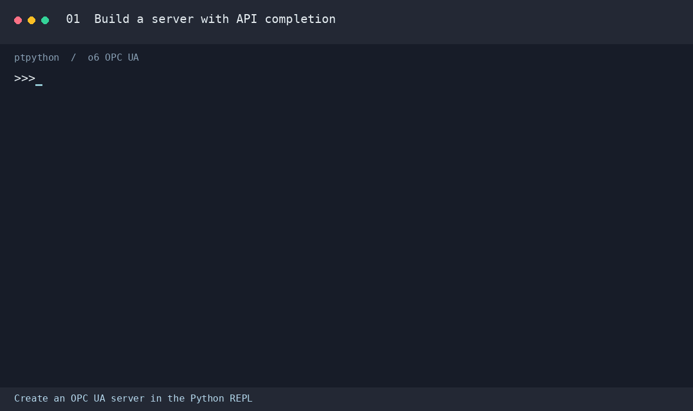
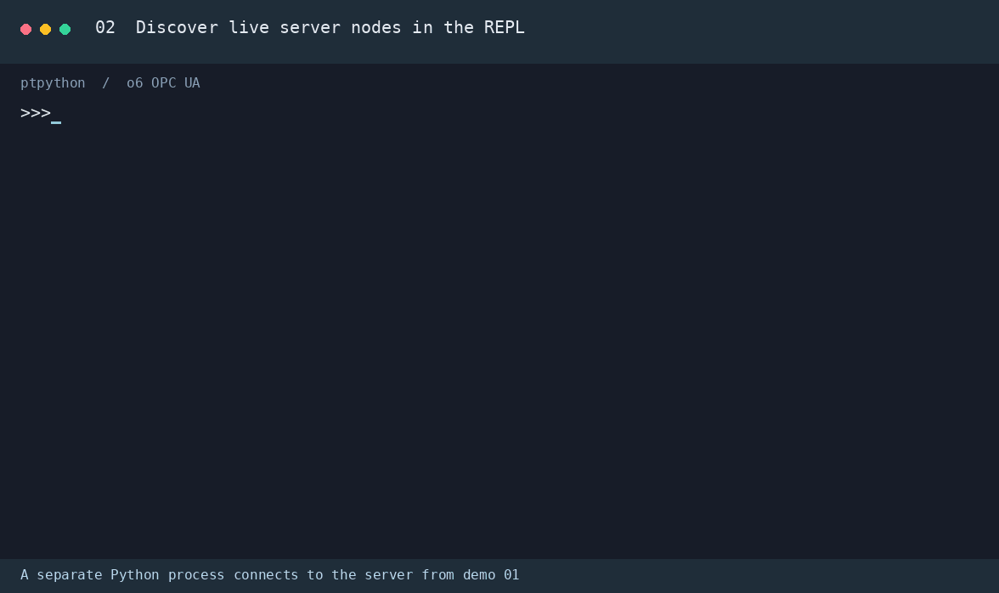

# ptpython completion demos

## 1. Build a basic server



ptpython completes `addObject`, `addVariable`, and `start`. The session creates
`Objects / Plant / Temperature`, initializes the variable to `22.5`, and starts
the server on `opc.tcp://localhost:4840`.

## 2. Explore the running server



A separate ptpython process connects to the **same server**, which is still
running from the first recording. Completion discovers `plant` under
`client.objects` and `temperature` under `client.objects.plant`. The session
reads `22.5`, writes `25.0`, and reads the updated value.

Both GIFs capture actual ptpython terminal output, including its completion
menus. They use ptpython's default Jedi completer; no mocked nodes, custom
completer, or predefined client schema is involved. The SDK's startup banner is
allowed to finish before capture, and SDK logging is set to `ERROR` for clarity.
The title and bottom caption are added by the renderer.

## Re-record

From the repository root, use a Python environment with a working build of this
checkout's `o6` package:

```sh
python -m pip install ptpython pexpect pyte Pillow
python tools/record_ptpython_demos.py
```

The recorder requires a Unix PTY and a free local TCP port. It starts and stops
its own server and client. Use `--port 4841` if port 4840 is occupied. On systems
without DejaVu Sans Mono at the default Linux path, pass
`--font /path/to/monospace.ttf`. Use `--output /path/to/folder` to change the
destination.

The adjacent `.cast` files retain the terminal output in asciicast v2 format.
They can be replayed with `asciinema play server-completion.cast` or
`asciinema play repl-completion.cast`.
