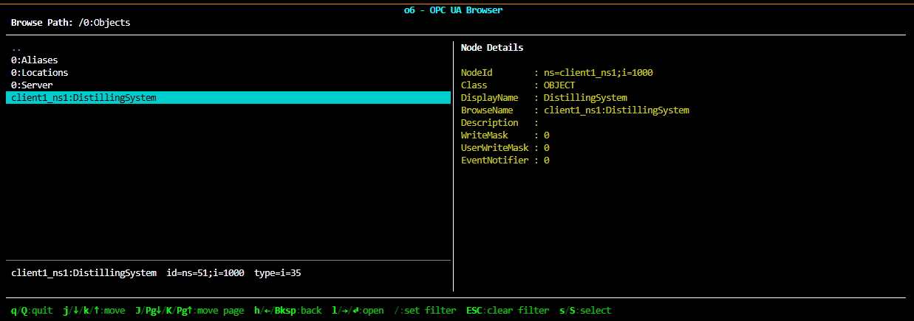

# Interactive Browser

``Client.browseInteractive()`` opens a terminal UI for the server's
address space. Arrow keys (or ``h/j/k/l``) move through the children of
the current node, ``Enter`` opens a child, ``h`` / ``Backspace`` goes
back up, ``/`` filters the children by a fuzzy substring match, and
``q`` quits.

``s`` on a child opens a dialog that quits and returns either the
**NodeId** of that node or its slash-delimited **BrowsePath**.
``browseInteractive()`` returns that string, which a script can pass to
``client.read(returned_string)`` without walking the tree again.



The example targets ``S03_firststeps.py``. ``browseInteractive()``
requires the standard-library ``curses`` module (on Windows, install
``windows-curses``).

!!! info "This example needs a running server"
    Start [Server First Steps](server-S03_firststeps.md) first:

    ```
    python examples/server/S03_firststeps.py
    ```

The interactive browser uses the same ``Browse`` service as
``client.browse()`` and ``client[NodeId]``, but shows the result in a
UI instead of returning Python objects.

## 1. Endpoint and starting node
The starting NodeId is optional. Without it the browser opens at the
Root folder (``i=84``). Pass a NodeId as a CLI argument to start
elsewhere, for example the Objects folder ``"i=85"`` or a sensor on
``S03_firststeps.py`` such as ``"ns=1;i=1001"``.

```python
localhost = "localhost"
endpoint_url = f"opc.tcp://{localhost}:4840"

start_nodeid: str | None = None
if len(sys.argv) > 1:
    start_nodeid = sys.argv[1]
    print(f"Starting browser at {start_nodeid}")
else:
    print("Starting browser at the address-space root (pass a NodeId to start elsewhere)")
```

## 2. Connect and launch the browser
The browser takes over the terminal until the user quits. The code
connects, runs the browser inside a ``with`` block, and lets
``__exit__`` close the session. A ``StatusCodeError`` from
``connect()`` (server down, wrong URL, authentication rejected) is
caught and reported. Exceptions raised while ``browseInteractive``
runs propagate out of the ``with`` block.

The function returns a NodeId string such as ``"ns=1;i=1001"``, a
BrowsePath such as ``"/Objects/Plant/Temperature"``, or ``None``,
depending on how the user quits. The example prints the result, so the
script works as a "find me a NodeId" tool from the shell.

```python
try:
    with Client(endpoint_url) as client:
        result = client.browseInteractive(start_nodeid)
        if result is not None:
            print()
            print(f"Selected: {result}")
except StatusCodeError as e:
    print(f"Error: failed to connect: {e.symbol} (0x{e.code:08x})")
    sys.exit(1)
```

## 3. Key bindings
The browser starts in navigation mode. ``/`` switches to filter mode,
where keystrokes edit the filter; ``Enter`` confirms it and ``Esc``
cancels it.

| key                       | action                                  |
|---------------------------|-----------------------------------------|
| ``j`` / Down              | move down one row                       |
| ``k`` / Up                | move up one row                         |
| ``J`` / Page Down         | move down one page                      |
| ``K`` / Page Up           | move up one page                        |
| ``h`` / Left / Backspace  | go back to the parent                   |
| ``l`` / Right / Enter     | open the highlighted child              |
| ``/``                     | start a fuzzy filter on the child list  |
| ``Esc``                   | clear the filter                        |
| ``s``                     | open the select dialog                  |
| ``q``                     | quit (returns ``None``)                 |

The select dialog has three options: quit with the NodeId (``n``), quit
with the BrowsePath (``p``), or cancel (``q``).

## Source Code

Download [`C12_browser.py`](client-C12_browser/C12_browser.py) to run it locally.
