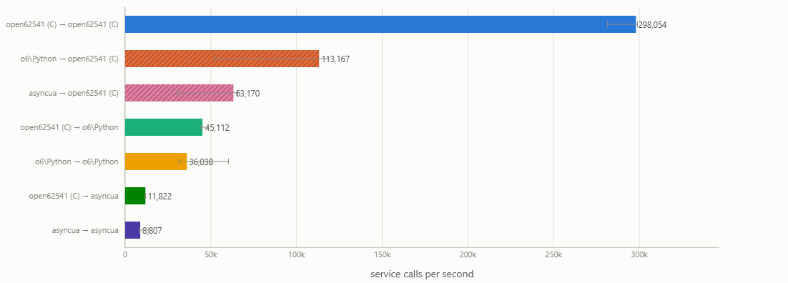
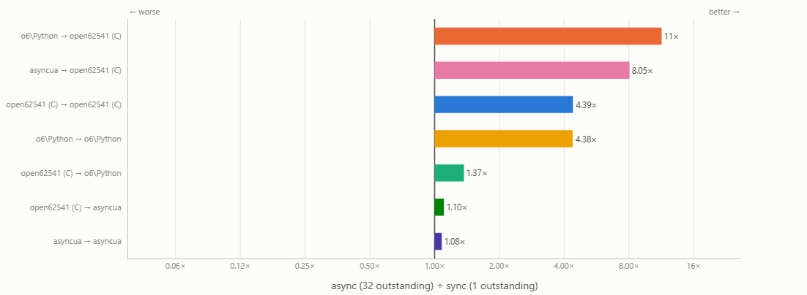
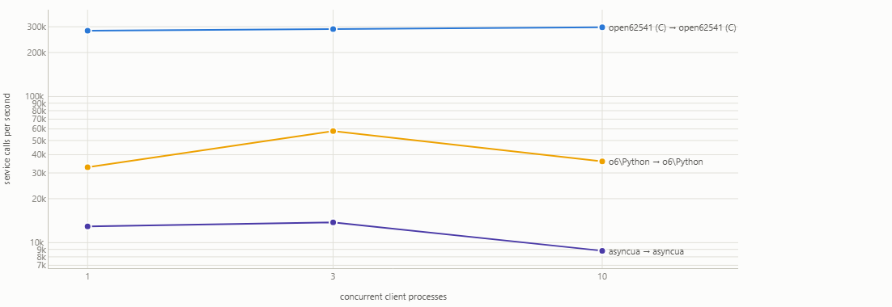
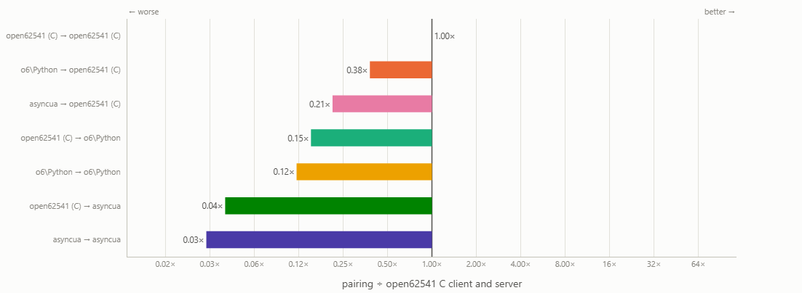

# Benchmarks

The end-to-end benchmark compares native open62541 C, o6\\Python and asyncua as
OPC UA clients and servers. The client and server roles vary independently, so
you can attribute cost to each side. The benchmark measures seven pairings:

| Client / server | Purpose |
| --- | --- |
| C / C | Native baseline |
| o6 / C and C / o6 | Isolate the o6 client and server |
| asyncua / C and C / asyncua | Isolate the asyncua client and server |
| o6 / o6 and asyncua / asyncua | Complete Python applications on both sides |

Each client is a separate process. All configurations access the same 100
writable `Int32` variables in the same NodeId sequence, one value per service
call, and start together at a common process barrier. Node objects are resolved
before timing starts. Each client performs 100 warm-up operations, then 2,000
timed operations. Every figure is the median aggregate throughput of five
samples.

Each async client keeps at most 32 requests outstanding. With one, three and ten
client processes, that is at most 32, 96 and 320 outstanding requests in total.

All rates are OPC UA service calls per second. Larger is better.

## Aggregate throughput

Ten concurrent client processes, up to 32 requests in flight per client, reads,
SecurityPolicy `#None`:

| Role | o6\\Python | asyncua | Ratio |
| --- | ---: | ---: | ---: |
| Client, against a C server | 113.2k | 63.2k | 1.8× |
| Server, driven by C clients | 45.1k | 11.8k | 3.8× |
| Python client and server | 36.0k | 8.8k | 4.1× |

The native C pairing reaches 298.1k calls/s in the same configuration. The
difference between the two Python stacks is larger in the server role than in
the client role.

## Effect of request pipelining

Async throughput (32 requests outstanding) divided by sync throughput (1
outstanding), per pairing, at ten clients:

The native pairing has a lower multiplier because its sync baseline is the
highest sync figure in the matrix.

Server-side pairings gain least: their throughput stays nearly constant across a
thirty-fold change in outstanding requests.

## Scaling with client count

Both Python pairings peak at three clients and decline at ten. The native
pairing stays flat. Ten client processes plus a server process oversubscribe
the twelve logical CPUs, so the ten-client samples scatter. At their peaks, the
two Python pairings differ by a factor of 4.2×.

## Relative to the native baseline

Each pairing divided by the native baseline (C client and C server):

| Role | o6\\Python | asyncua |
| --- | ---: | ---: |
| Client, against a C server | 38% | 21% |
| Server, driven by C clients | 15% | 4% |
| Python client and server | 12% | 3% |

## Test system

Recorded on 6 August 2026, 05:52 UTC:

| Component | Configuration |
| --- | --- |
| Processor | 13th Gen Intel Core i5-1345U, 12 logical processors |
| Memory | 16 GB (15.45 GiB reported) |
| Operating system | Linux 6.6.87.2-microsoft-standard-WSL2, x86_64, glibc 2.39 |
| Python | CPython 3.12.3 |
| Transport | OPC UA TCP over loopback |