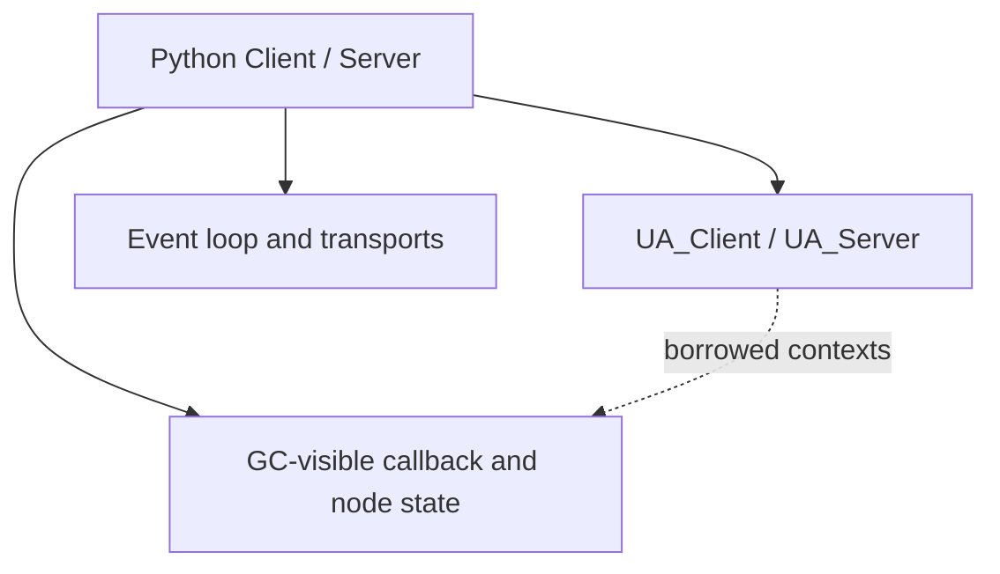

# Memory management

## Ownership contract

| Resource | Owner / lifetime |
| --- | --- |
| Native client or server | Python wrapper |
| Method/Variable callback state | Promoted node or server runtime callback references |
| Access-control sessions | Server runtime callback references |
| Access-control and history plugins | Native contexts traversed by the server |
| Client subscriptions, monitored items, pending services | Native contexts tracked and traversed by the client |
| Promoted server node | Combined native/Python allocation; deletion detaches the wrapper |
| Pending asynchronous Method state | Server ownership list and its Task until completion/cancellation |
| Client configuration | Cached wrapper with an invalidated borrowed pointer after client teardown |
| Server configuration | Strong reference retaining its server |
| Decoded values and arrays | Independent Python copies |

Explicit `disconnect()`, `stop()`, and context managers control network
lifecycle. Stopping a server retains its address space for subsequent use.
Dropping an owner relies on reference counting and cyclic GC for final cleanup.

## GC boundaries

Client/server wrappers expose owned Python references through `tp_traverse`,
including native plugin and callback contexts. A C allocation holding
`PyObject *` is not automatically visible to Python GC. New native owners must
join the endpoint's traversal and release their references during teardown.

Client contexts leave their tracking lists before releasing Python references.
Native cleanup runs before `tp_clear` discards wrapper references, so native
callbacks cannot retain dangling borrowed pointers.

## Native teardown

1. Disable callbacks that could enter Python during native deletion.
2. Cancel or detach pending operations and invalidate borrowed pointers.
3. Stop event sources and detach transports.
4. Delete the native client/server while lifecycle state is still valid.
5. Release remaining Python references and namespace mappings.

Queued transport callbacks can run after detachment and must tolerate it.
No transport callback may dereference a deleted owner.

## Conversion ownership

`UA2PY` copies native values into Python. Endpoint mapping uses an owned copy
and preserves the native input.
Binary/JSON decoder temporaries and cached DataValue Variants are cleared
after conversion. Returned NumPy arrays own separate storage.

## Validation

Ownership changes need success, submission failure, cancellation, and teardown
coverage. Include a callback closing over its owner and check reclamation with
`weakref` after `gc.collect()`. Exercise queued transport callbacks during
shutdown and run native allocation checks for paths Python GC cannot observe.

See [client lifecycle](../client/lifecycle.md),
[server lifecycle](../server/lifecycle.md), and
[wire-format mapping](wire-format-mapping.md).
