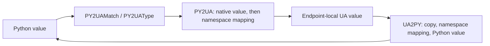

# Wire-format and Python-value mapping

| UA datatype | Python representation |
| --- | --- |
| Boolean | `bool` on decode; Python and NumPy booleans accepted |
| Sized signed/unsigned integer | Corresponding NumPy scalar (`o6.Int32`, etc.) |
| Float / Double | `numpy.float32` / `numpy.float64` |
| String / XmlElement | `str` / `o6.XmlElement` |
| ByteString | `bytes` |
| NodeId / ExpandedNodeId / QualifiedName / LocalizedText | Corresponding `o6` wrapper |
| Guid | `uuid.UUID` |
| DateTime | `o6.DateTime`; construction also accepts `datetime.datetime` |
| Structure / optional structure / union | Registered Python datatype class |
| Variant | The contained Python value; no public Variant wrapper |
| DataValue / DiagnosticInfo | Corresponding `o6` wrapper |
| Enum / integer OptionSet | Registered enum/flag class when available |

## Type inference

| Input | Inferred UA datatype |
| --- | --- |
| Bare `bool` | Boolean |
| Bare `int` | Int32; conversion rejects values outside its range |
| Bare `float` | Double |
| Sized `o6`/NumPy scalar | Corresponding width |
| Non-empty Python sequence | Element type inferred from its first element |
| Typed NumPy array | Datatype selected from the dtype |
| `None` | Empty Variant |

Use `o6.Float(...)` for a Float value and `o6.Int64(...)` for a wider signed
integer. Plain empty sequences need explicit element-type information.

## Empty strings

| Python input | Binary representation |
| --- | --- |
| `""`, empty XmlElement, empty QualifiedName name | Null String: `ff ff ff ff` |
| `b""` | Empty ByteString: `00 00 00 00` |

Both null and empty UA Strings decode as `""`. The String normalization
supports peers that distinguish unset service filters from explicitly empty
strings. ByteStrings retain their empty representation.

## Arrays and ownership

- Decoding allocates a NumPy array and copies values into it.
- Encoding contiguous native-endian numeric arrays uses a bulk copy.
- Other arrays are converted element by element in logical order.
- Variant decoding accepts at most 10 dimensions. Inconsistent dimension metadata falls back to a flat array.
- Structure array fields require one-dimensional input.
- `UA2PY` copies values into Python; callers retain responsibility for clearing the input native value.
- Endpoint namespace mapping operates on an owned copy; native input values remain unchanged.

## Implementation and validation

| Source | Responsibility |
| --- | --- |
| `src/types.c` | Type inference and registry lookup |
| `src/types_convert.c` | Recursive value conversion |
| `src/types_mapping.c` | Recursive namespace translation |
| `src/types_encoding.c` | Standalone binary, JSON, and XML codecs |
| `tests/common/test_types.py`, `tests/common/test_struct.py` | Value and structure contracts |
| `tests/common/test_conversion_validation.py` | Invalid decoder arguments and conversion inputs |
| `tests/namespaces/` | Endpoint namespace round trips |

Standalone codecs use process-global indexes. Client/server services use the
endpoint mapping. See [namespace matching](namespace-matching.md) and
[memory management](memory-management.md).
