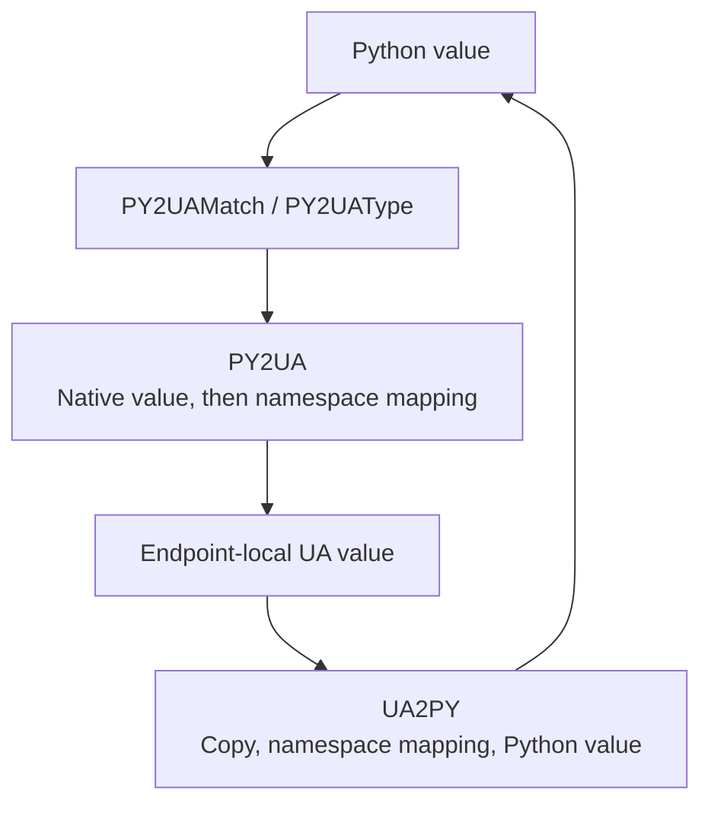
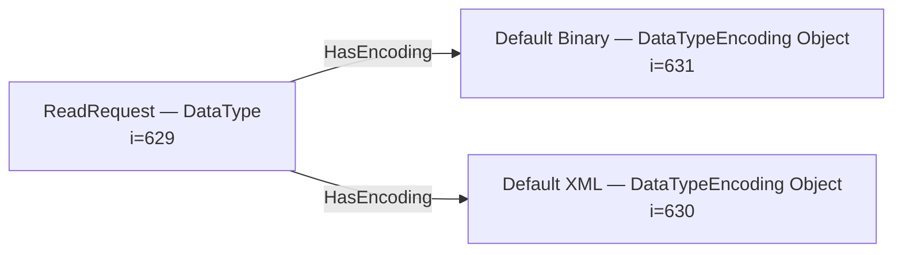

# Wire-format and Python-value mapping

Use this page when inspecting encoded values or diagnosing type conversion.
It assumes the [DataType](../opcua-fundamentals/datatype.md) and
[namespace mapping](../sdk-fundamentals/namespace/namespace-mapping-in-o6.md)
concepts from the earlier chapters.



| UA datatype | Python representation |
| --- | --- |
| Boolean | `bool` on decode; Python and NumPy booleans accepted |
| Sized signed/unsigned integer | Corresponding NumPy scalar (`o6.Int32`, etc.) |
| Float / Double | `numpy.float32` / `numpy.float64` |
| String / XmlElement | `str` / `o6.XmlElement` |
| ByteString | `bytes` |
| NodeId / ExpandedNodeId / QualifiedName / LocalizedText | Corresponding `o6` wrapper |
| Guid | `uuid.UUID` |
| DateTime | `o6.DateTime`; construction also accepts `datetime.datetime` |
| Structure / optional structure / union | Registered Python datatype class |
| Variant | The contained Python value; no public Variant wrapper |
| DataValue / DiagnosticInfo | Corresponding `o6` wrapper |
| Enum / integer OptionSet | Registered enum/flag class when available |

## Structured values and encoding IDs

A DataType node identifies the model type. A DataTypeEncoding Object identifies
one representation of that type. For example:



The encoding Object's NodeId is separate from the namespace of its BrowseName.
The standard BrowseNames `Default Binary` and `Default XML` have namespace
index zero, including for custom types whose encoding Objects have NodeIds in
the model's namespace.

### ExtensionObject envelope

In OPC UA Binary, a structure carried in a Variant uses an ExtensionObject.
Fields that allow different concrete structure types also use an
ExtensionObject to identify the actual type. For a non-null binary body, the
layout is:

```text
ExtensionObject
├── TypeId       NodeId of the DataTypeEncoding Object
├── Encoding     Byte: 0x01 for a binary body
├── Length       Int32: number of body bytes
└── Body         structure fields in their declared order
```

`TypeId` selects the encoding Object, not the DataType node. `Length` lets a
receiver skip or retain an unknown body without decoding its fields. The
format is defined in [Part 6, ExtensionObject](https://reference.opcfoundation.org/Core/Part6/v105/docs/5.2.2.15).

A fixed concrete structure field is encoded inline. Its containing definition
already identifies its layout, so it carries no additional TypeId or
ExtensionObject envelope. Arrays of such structures similarly encode their
length and then the elements. Optional fields and unions have their own masks
or selectors. See [Part 6, Structures](https://reference.opcfoundation.org/Core/Part6/v105/docs/5.2.6).

### A ReadRequest service message

A binary service message has different framing from an ExtensionObject. Its
message body starts with the encoding NodeId followed by the request fields;
there is no ExtensionObject Encoding byte or Length field at this level.
The following sketch omits transport and security headers:

```text
Read service message body
├── Encoding NodeId = i=631       ReadRequest Default Binary encoding
└── ReadRequest fields            DataType = i=629
    ├── requestHeader             RequestHeader, encoded inline
    ├── maxAge                    Double
    ├── timestampsToReturn        TimestampsToReturn, encoded as Int32
    └── nodesToRead                array of ReadValueId (DataType i=626)
        ├── array length
        └── element 0             encoded inline, without a TypeId
            ├── nodeId = i=2255   NamespaceArray Variable to read
            ├── attributeId = 13  UInt32: the Value attribute
            ├── indexRange        String
            └── dataEncoding      QualifiedName
```

The SDK's `ReadRequest` declaration supplies this field layout. Applications
using `client.read(...)` do not need to build or parse it. The
[raw service interface](../client/raw-services.md) exposes request objects when
needed. The message framing is defined in
[Part 6, Messages](https://reference.opcfoundation.org/Core/Part6/v105/docs/5.2.9).

## Type inference

The public defaults and examples are in
[Choosing a value's type](../sdk-fundamentals/builtin/primitive-types.md#choosing-a-values-type).
`PY2UAMatch` selects the scalar or array shape, and `PY2UAType` resolves the
Python type to an OPC UA datatype. A Variant payload uses that inferred type;
conversion into a declared structure field uses the field's known datatype.

## Empty strings

| Python input | Binary representation |
| --- | --- |
| `""`, empty XmlElement, empty QualifiedName name | Null String: `ff ff ff ff` |
| `b""` | Empty ByteString: `00 00 00 00` |

Both null and empty UA Strings decode as `""`. Encoding `""` as null supports
peers that distinguish unset service filters from explicitly empty strings.
ByteStrings keep their empty representation.

## Arrays and ownership

- Decoding allocates a NumPy array and copies values into it.
- Encoding contiguous native-endian numeric arrays uses a bulk copy.
- Other arrays are converted element by element in logical order.
- Variant decoding accepts at most 10 dimensions. Inconsistent dimension metadata falls back to a flat array.
- Structure array fields require one-dimensional input.
- `UA2PY` copies values into Python; callers retain responsibility for clearing the input native value.
- Endpoint namespace mapping operates on an owned copy; native input values remain unchanged.

## Implementation and validation

| Source | Responsibility |
| --- | --- |
| `src/types.c` | Type inference and registry lookup |
| `src/types_convert.c` | Recursive value conversion |
| `src/types_mapping.c` | Recursive namespace translation |
| `src/types_encoding.c` | Standalone binary, JSON, and XML codecs |
| `tests/common/test_types.py`, `tests/common/test_struct.py` | Value and structure contracts |
| `tests/common/test_conversion_validation.py` | Invalid decoder arguments and conversion inputs |
| `tests/namespaces/` | Endpoint namespace round trips |

Standalone codecs use process-global indexes. Client/server services use the
endpoint mapping. See [namespace matching](namespace-matching.md) and
[memory management](memory-management.md).
