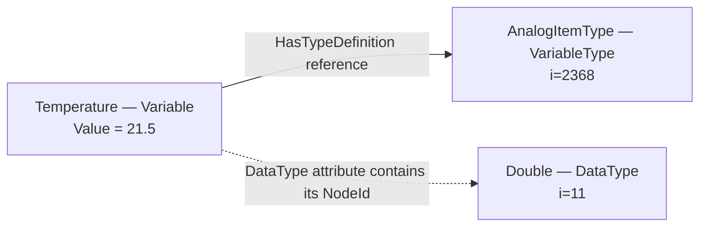
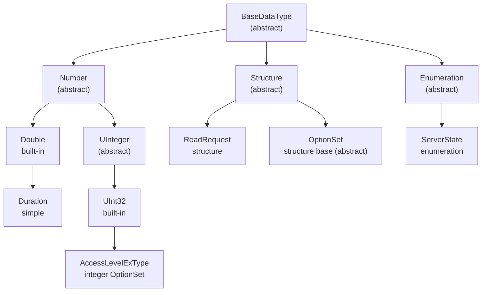
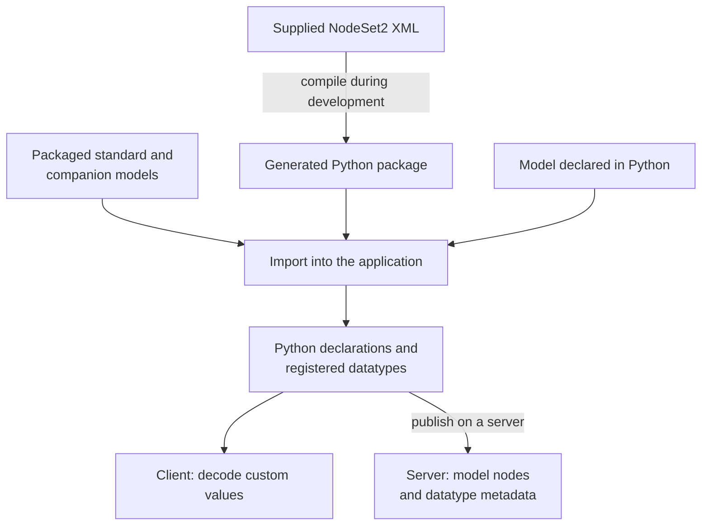

# DataType

A *DataType* describes the values a Variable can hold or a Method argument can
carry: a number, text, an enumeration, or a structure with named fields. Each
DataType has a node in the address space, identified by a NodeId. For example,
`Double` is `i=11` in the standard namespace.

## DataType and type definition

Consider a temperature measurement with a current value of `21.5`:



The VariableType describes the kind of node, including its metadata and child
nodes. `AnalogItemType`, for example, describes an analog measurement with a
range Property. The DataType describes the value: this Temperature Variable
holds a Double. In server creation APIs, these are the separate arguments
`typeDefinition=` and `dataType=`.

A VariableType also has a DataType attribute that constrains its instances.
`AnalogItemType` allows numeric values; this instance narrows that to Double.
The Variable's `ValueRank` and `ArrayDimensions` attributes specify whether its
value is a scalar or an array and constrain its shape. These attributes and
references are defined in [Part 3, Variable NodeClass](https://reference.opcfoundation.org/Core/Part3/v105/docs/5.6.2).

Objects use `HasTypeDefinition` to identify an ObjectType. Methods describe
input and output values through their argument definitions. A ReferenceType
describes a relationship between nodes. These NodeClasses do not use a DataType
as their `HasTypeDefinition` target.

## Kinds of values

The following examples show how the kinds fit into the DataType hierarchy.
Each arrow is a `HasSubtype` reference from a base type to a subtype; branches
not needed for these examples are omitted.



A simple type such as `Duration` adds meaning while retaining its built-in
base's representation. A structure groups named fields. An enumeration selects
one named Int32 value; an OptionSet combines flags. The two OptionSet forms
belong to different branches: an unsigned integer subtype or a structure with
`Value` and `ValidBits` fields. Abstract types constrain the permitted concrete
values. See [Part 3, DataTypes](https://reference.opcfoundation.org/Core/Part3/v105/docs/5.8).

[Primitive Types](../sdk-fundamentals/builtin/primitive-types.md) explains how
built-in values appear in Python. [Declaring Custom DataTypes](../information-model-authoring/datatypes.md)
covers structures, enumerations, unions, and both OptionSet forms.

## DataType NodeClass

A DataType node has the common node attributes, such as `NodeId` and
`BrowseName`, plus `IsAbstract`. Its `HasSubtype` references place it in the
datatype hierarchy. Properties can describe enumeration choices or OptionSet
bit names.

The `DataTypeDefinition` attribute describes a type's fields or named values.
For a structure, a `StructureDefinition` records its base type, encoding ID,
and ordered fields. For an enumeration, an `EnumDefinition` records its
choices. The applicability rules are in
[Part 3, DataType NodeClass](https://reference.opcfoundation.org/Core/Part3/v105/docs/5.8.3).

!!! info "Integer OptionSets in o6\\Python"
    Part 3 requires `DataTypeDefinition` for OptionSets as well. The SDK's
    integer-form OptionSets do not expose that attribute: reading it returns
    `BadAttributeIdInvalid`. Their bit names are published in the
    `OptionSetValues` Property. This is an SDK limitation; it does not change
    the standard's requirement. See [integer OptionSets](../information-model-authoring/datatypes.md#o6optionsettype-option-sets).

### A structure's field layout

`ReadRequest` is DataType `i=629`. Its `DataTypeDefinition` describes the
layout below. Field names use the Python spelling from o6\\Python; each field
also records its shape and whether it is optional.

```text
ReadRequest — DataType i=629
└── DataTypeDefinition: StructureDefinition
    ├── baseDataType       Structure (i=22)
    ├── defaultEncodingId  Default Binary encoding (i=631)
    ├── structureType      Structure
    └── fields            ordered; all four are required
        ├── requestHeader       RequestHeader (i=389), scalar
        ├── maxAge              Double (i=11), scalar
        ├── timestampsToReturn  TimestampsToReturn (i=625), scalar
        └── nodesToRead         ReadValueId (i=626), array
            └── each element
                ├── nodeId        NodeId
                ├── attributeId   UInt32
                ├── indexRange    String
                └── dataEncoding  QualifiedName
```

The expanded `ReadValueId` branch shows that type's own field layout; those
fields are not additional entries in `ReadRequest.fields`.

Each `ReadValueId` identifies a node and an attribute to read. For example,
`nodeId=i=2255` selects the NamespaceArray Variable and `attributeId=13`
selects its Value. The request's type, the field's type, and the target node
are three different identities.

A structure's DataType node and its encoding object also have distinct IDs:
`ReadRequest` is `i=629`, while its Default Binary encoding is `i=631`.
The optional [wire-format chapter](../implementation-details/wire-format-mapping.md#structured-values-and-encoding-ids)
explains how those IDs are used in messages.

When a structure is carried inside a Variant, it uses an ExtensionObject to
identify its encoding. A field with a fixed concrete structure type can be
encoded directly according to its declared layout. A structure does not need
an ExtensionObject around every nested field. See
[Part 6, Structures](https://reference.opcfoundation.org/Core/Part6/v105/docs/5.2.6).

With a loaded datatype declaration, o6\\Python exposes a structured value as a
Python object with named attributes. Unknown structures may remain opaque
`ExtensionObject`s; [Loading & Using Nodesets](../sdk-fundamentals/namespace/loading-and-using-nodesets.md#namespace-modules-load-lazily)
explains how to load the declarations needed to decode them.

## Where DataType definitions come from

The standard namespace supplies built-in and standard model types. Companion
specifications and application models define additional types in their own
namespaces.

The application workflow has three entry points:



Packaged models are already compiled. Supplied XML needs compilation before
runtime; handwritten Python models can be imported directly. Importing supplies
the declarations, while server publication creates their address-space nodes.
See [Loading & Using Nodesets](../sdk-fundamentals/namespace/loading-and-using-nodesets.md)
for the workflow and lazy-loading rules.

## Related topics

| Topic | What it covers |
|---|---|
| [Part 3, §5.8 — DataTypes](https://reference.opcfoundation.org/Core/Part3/v105/docs/5.8) | The specification's datatype model and NodeClass. |
| [Primitive Types](../sdk-fundamentals/builtin/primitive-types.md) | Built-in OPC UA values in Python. |
| [Loading & Using Nodesets](../sdk-fundamentals/namespace/loading-and-using-nodesets.md) | Importing declarations to use custom types. |
| [Wire-format and Python-value mapping](../implementation-details/wire-format-mapping.md#structured-values-and-encoding-ids) | Encoding identities, ExtensionObjects, and service message layout. |
