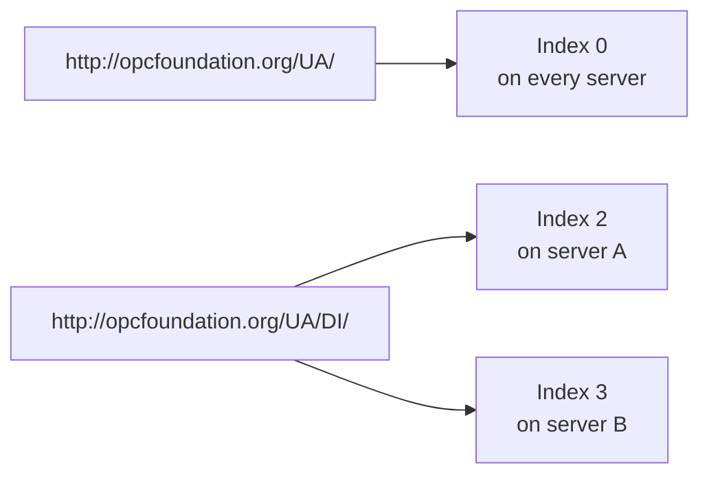
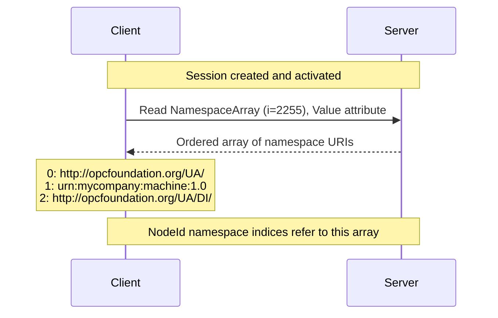

# Namespace

A *namespace* gives NodeIds a common identity domain, so identifiers assigned
by different vendors or standards bodies can coexist in one address space.
A namespace URI identifies that domain. Every node's NodeId includes a
namespace, whether the node is an Object, Variable, Method or type definition.

In a NodeId exchanged with a server, a 16-bit *namespace index* selects the URI
from that server's namespace table. The URI identifies the namespace; the
index is a server-local lookup value.

## What this page covers

This page summarizes the key concepts. It is not a complete reference. It
follows the `AddressSpace` concepts of the normative
[Part 3, §4](https://reference.opcfoundation.org/Core/Part3/v105/docs/4), in
the order of [Part 3, §4.2](https://reference.opcfoundation.org/Core/Part3/v105/docs/4.2)
and [Part 3, §4.4](https://reference.opcfoundation.org/Core/Part3/v105/docs/4.4):

1. **URI vs index**: what is stable, what is server-local, and how they map.
2. **The Namespace array**: how a server publishes the URI ↔ index mapping to clients.
3. **`ns0` is special**: why namespace 0 is fixed and what it carries.
4. **`ns1` is special too**: why the server-local namespace sits at index 1.

---

## URI vs index

A namespace index is meaningful in the context of a particular server
and its namespace table. The same URI can occupy different indices:



Two different servers can hold the same URI at different indices. Every
server exposes its URI ↔ index table as a Variable. Clients read that table
and use it to resolve `NodeId`s.

The specification requires: "Programs shall always treat URIs as opaque strings that can only be tested for equality with a case sensitive string comparison" ([Part 3, §4.2](https://reference.opcfoundation.org/Core/Part3/v105/docs/4.2)).

---

## The Namespace array

Every server exposes one *Namespace array*: an ordered list of URI strings
that defines the server's URI ↔ index mapping. Clients read the Value attribute of
the `NamespaceArray` Variable (`i=2255`) after establishing a session; it is
not part of the `CreateSession` response.



The array contains URI strings only. A server can expose version and
publication-date information separately through `NamespaceMetadataType`
Objects; see [Part 5, §6.3.13](https://reference.opcfoundation.org/specs/OPC-10000-5/6.3.13).

- Index `0` always contains `http://opcfoundation.org/UA/`; index `1`
  contains the server's `ApplicationUri`.
- While any session is open, the server may append entries but must not
  modify or delete existing ones. Clients that cache indices must check the
  mapping when starting a new session.
- A URI-based identifier can be resolved to a local index when that URI
  occurs in the server's table. A URI absent from the table has no local index
  on that server.

The namespace-table rules are defined in
[Part 5, §6.3.1](https://reference.opcfoundation.org/specs/OPC-10000-5/6.3.1);
reading its Value uses the
[Read service](https://reference.opcfoundation.org/Core/Part4/v105/docs/5.11.2).

---

## `ns0` is special

Namespace 0, URI `http://opcfoundation.org/UA/`, is defined by the OPC UA
specification. Every server must expose it, and its index is always `0`,
regardless of when the server starts or which nodesets it loads. It holds the
service envelopes, filter and query operands, metadata structures and standard
enums that the protocol is built on.

o6\\Python ships `ns0` pre-generated. Access its content through `o6.ns.ns0`:

```python
import o6

req = o6.ns.ns0.datatypes.ReadRequest()
o6.ns.ns0.datatypes.NodeId          # the NodeId DataType, i=17
o6.ns.ns0.datatypes.ExpandedNodeId  # the ExpandedNodeId DataType, i=18
o6.ns.ns0.datatypes.ReadRequest     # the ReadRequest DataType, i=629
```

---

## `ns1` is special too

Namespace index `1` is reserved for the local server's `ApplicationUri`.
A server can use it for application-specific nodes. Vendor models and nodes
created at runtime can also use other registered namespaces.

The standard Server Object and its standard children have namespace-zero
NodeIds, even though they describe this particular server:

| Node | NodeId |
| --- | --- |
| Server | `ns=0;i=2253` |
| ServerArray | `ns=0;i=2254` |
| NamespaceArray | `ns=0;i=2255` |
| ServerStatus | `ns=0;i=2256` |
| ServerCapabilities | `ns=0;i=2268` |
| ServerRedundancy | `ns=0;i=2296` |

Omitting `ns=0;` gives the equivalent short form, such as `i=2255`.
The URI in `NamespaceArray[1]` identifies the server's namespace; it does not
change the NodeIds of these standard nodes.

---

## Additional namespaces and nodesets

Indices `2`, `3`, … identify additional namespaces registered by the server.
Their nodes may come from an imported model or be created in application code.

A namespace identifies nodes. A *NodeSet* XML file describes model content
that can be loaded or compiled; XML is one way to distribute that content.
o6\\Python also supports declaring a model directly in Python. See
[Nodeset Files & Companion Specs](nodesets-and-companion-specs.md) for the file
format and its relationship to a specification.

## Using namespaces in o6\\Python

The SDK's `o6.ns` registry associates URIs with Python shortnames and
process-global indices. Those indices can differ from a server's local
NamespaceArray indices; shortnames are not entries in NamespaceArray.
[Registry and Namespace Mapping](../sdk-fundamentals/namespace/namespace-mapping-in-o6.md)
explains the translation, including the special `ns=1` alias.

Importing a namespace module makes its model available to the Python process.
A server publishes its model with `server.ns.append(module)`; a client imports
it to use its declarations and decode its types. See
[Loading & Using Nodesets](../sdk-fundamentals/namespace/loading-and-using-nodesets.md)
for both workflows.

---

## Related topics

| Topic | What it covers |
|---|---|
| [Part 3, §4.2 — URIs](https://reference.opcfoundation.org/Core/Part3/v105/docs/4.2) | URI definitions in the OPC UA specification. |
| [Part 3, §4.4 — Node Model](https://reference.opcfoundation.org/Core/Part3/v105/docs/4.4) | Namespaces and identifiers in the node model. |
| [Part 5, §6.3.1 — ServerType](https://reference.opcfoundation.org/specs/OPC-10000-5/6.3.1) | Server and namespace arrays, reserved indices, and mapping stability. |
| [Address & Identity Types](../sdk-fundamentals/builtin/address-types.md) | NodeId, ExpandedNodeId, and QualifiedName values in Python. |
| [Namespace Mapping in o6\\Python](../sdk-fundamentals/namespace/namespace-mapping-in-o6.md) | The process-wide namespace registry and URI resolution. |
| [Loading & Using Nodesets](../sdk-fundamentals/namespace/loading-and-using-nodesets.md) | Loading namespaces and addressing their nodes. |
| [Nodesets and Companion Specs](nodesets-and-companion-specs.md) | Packaging and distributing information models. |
