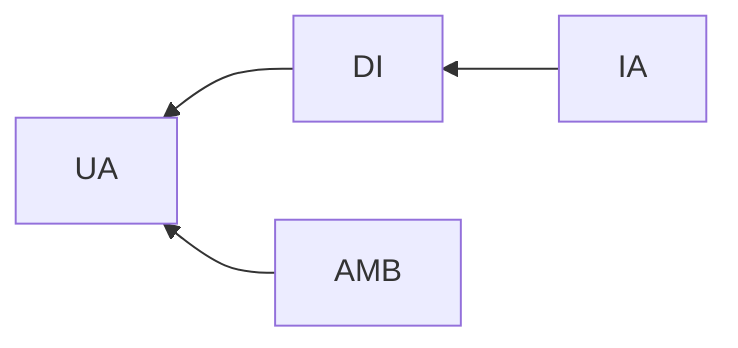
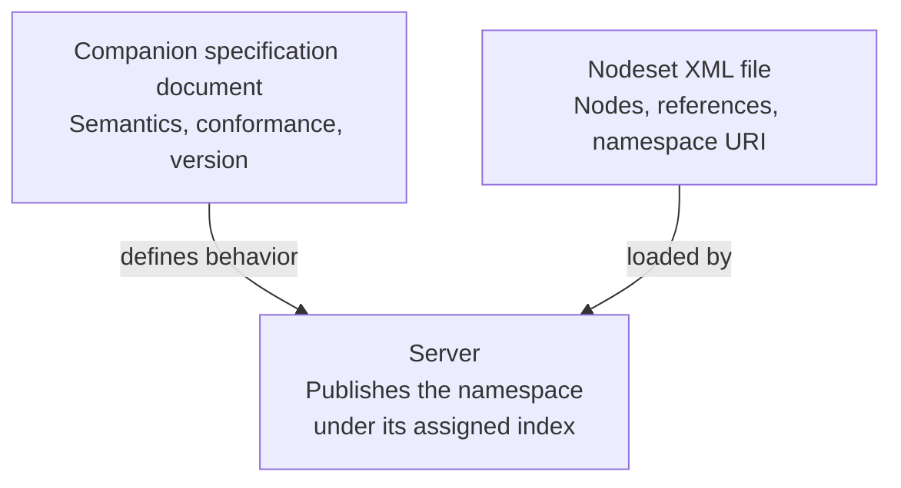

# Nodeset Files & Companion Specs

A *nodeset* is an XML file that describes information-model content: nodes,
their attributes, and references between them. Vendors and standards bodies
use nodesets to distribute models that applications can load or compile.
A server can also create nodes directly in code without loading XML.

A *companion specification* defines an OPC UA information model for a domain,
including its meaning, required behavior and conformance requirements. Its
NodeSet files supply machine-readable model definitions. Implementing the
specification also requires application behavior, such as supplying live
values and handling Method calls.

## What this page covers

This page summarizes the key concepts. It is not a complete reference. It
follows the structure of
[Part 6, Annex F](https://reference.opcfoundation.org/Core/Part6/v105/docs/F):

1. **What a nodeset is**: the file format's role in the address space.
2. **Companion specs**: what they are and how they relate to nodesets.

---

## What a nodeset is

A nodeset conforms to the `UANodeSet` XML schema. It records model and
namespace URIs, node definitions and references. Its nodes can refer to types
from other models, so the file's declared dependencies must also be available.
A namespace can be used independently of whether its model was distributed
as XML.

A nodeset lists model dependencies in `<RequiredModel>` entries. The
headers in [`OPCFoundation/UA-Nodeset`](https://github.com/OPCFoundation/UA-Nodeset)
give this dependency graph for a few representative companion specifications:

An arrow means "depends on". The IA model builds on DI, which builds on the
base UA model. Applications need the referenced definitions available;
the specification's conformance requirements determine which nodes and
behaviors a particular server must expose.

Loading model definitions creates types and other declared nodes. Application
code supplies live data and Method behavior. The set of nodes created and the
handling of existing nodes depend on the loader. In o6\\Python, the
[import and append workflows](../sdk-fundamentals/namespace/loading-and-using-nodesets.md)
distinguish loading Python declarations from publishing nodes on a server.

NodeSet XML is a model exchange format. The
[binary](https://reference.opcfoundation.org/Core/Part6/v105/docs/5.2),
[XML](https://reference.opcfoundation.org/Core/Part6/v105/docs/5.3) and
[JSON](https://reference.opcfoundation.org/Core/Part6/v105/docs/5.4) wire encodings
serve a separate purpose: exchanging values and messages.

---

## NodeSet XML schema

The root element of a nodeset is `UANodeSet`. The full XML schema is in
[Part 6, Annex F — Information Model XML Schema](https://reference.opcfoundation.org/Core/Part6/v105/docs/F).
The versioned XSDs are in
[`OPCFoundation/UA-Nodeset`](https://github.com/OPCFoundation/UA-Nodeset).

---

## Companion specs

A companion specification is the human-readable document that an
organization publishes with its nodeset. It gives the nodeset meaning: what
the types represent, what the methods do and which rules a client can rely on.
It is also the stable place for version notes and conformance claims.

Examples include Device Integration (DI), Industrial Automation (IA), ISA-95
and industry-specific models listed in the
[OPC Foundation catalogue](https://opcfoundation.org/about/opc-partners/opc-unified-architecture/opc-ua-companion-specifications/).
These models can build on one another, as the dependency graph above shows.
PubSub is part of the core OPC UA standard,
[Part 14](https://reference.opcfoundation.org/specs/OPC-10000-14/1).

Vendors can distribute their own information models as NodeSet files too.
The file format alone does not make a model a companion specification.

For a model distributed as XML, the document, file and server have different roles:

Finding a model's URI in `NamespaceArray` confirms that the server has
registered that namespace. It does not establish that the server implements
all nodes, required behavior or conformance units of the companion
specification. Check the specification's requirements and the server's
documented conformance claims, and verify the nodes and operations your
application needs.

The [OPC Foundation website](https://opcfoundation.org/about/opc-partners/opc-unified-architecture/opc-ua-companion-specifications/)
lists companion specifications. Published model files and their versions are
available in [`OPCFoundation/UA-Nodeset`](https://github.com/OPCFoundation/UA-Nodeset).

---

## Related topics

| Topic | What it covers |
|---|---|
| [Part 6, Annex F — Information Model XML Schema](https://reference.opcfoundation.org/Core/Part6/v105/docs/F) | The normative nodeset XML format. |
| [`OPCFoundation/UA-Nodeset`](https://github.com/OPCFoundation/UA-Nodeset) | Versioned XML schemas and published nodeset files. |
| [Namespace](namespace.md) | Namespace URIs, indices, and the namespace array. |
| [Part 5, §6.3.1 — ServerType](https://reference.opcfoundation.org/Core/Part5/v105/docs/6.3.1) | Server namespace information and startup behaviour. |
| [OPC UA Companion Specifications](https://opcfoundation.org/about/opc-partners/opc-unified-architecture/opc-ua-companion-specifications/) | The official catalogue of companion specifications. |
| [Namespace Mapping in o6\\Python](../sdk-fundamentals/namespace/namespace-mapping-in-o6.md) | How nodesets are represented in the Python namespace registry. |
