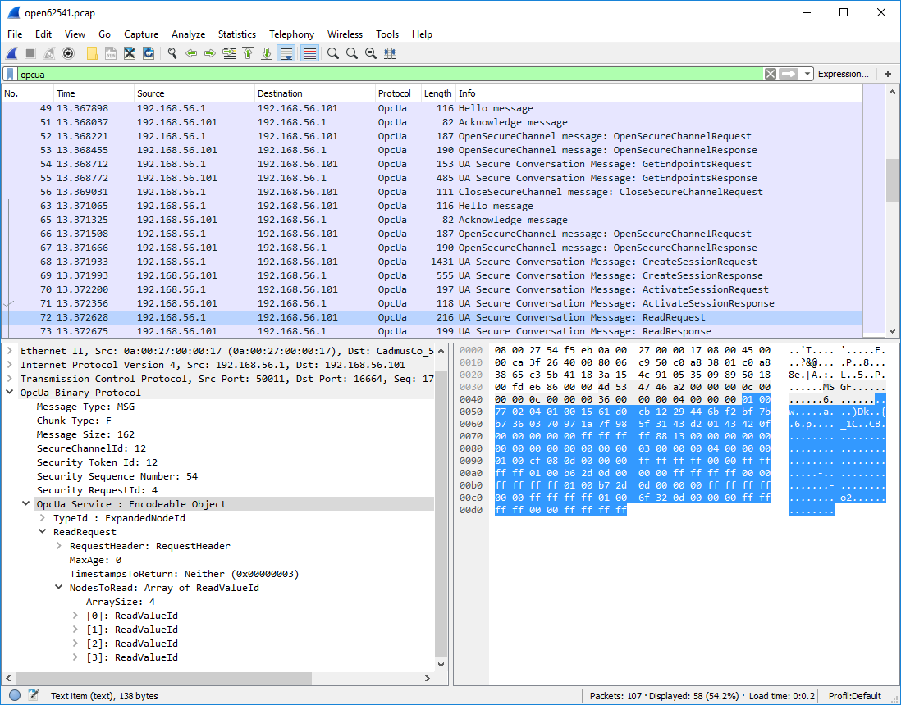

# Protocol

We focus on the TCP-based binary protocol since it is by far the most common transport layer for OPC UA. The general concepts also translate to HTTP and SOAP-based communication defined in the standard. Communication in OPC UA is best understood by starting with the following key principles:

## Request / Response

All communication is based on the Request/Response pattern. Only clients can send a request to a server. And servers can only send responses to a matching request. Often the server is hosted close to a (physical) device, such as a sensor or a machine tool.

## Asynchronous Responses

A server does not have to immediately respond to requests and responses may be sent in a different order. This keeps the server responsive when it takes time until a specific request has been processed (e.g. a method call or when reading from a sensor with delay). Subscriptions (push-notifications) are implemented via special requests where the response is delayed until a notification is published.

!!! info
    OPC UA PubSub (Part 14 of the standard) is an extension for the integration of many-to-many communication with OPC UA. PubSub does not use the client-server protocol. Rather, OPC UA PubSub integrates with either existing broker-based protocols such as MQTT, UDP-multicast or Ethernet-based communication. Typically an OPC UA server (accessed via the client-server protocol) is used to configured PubSub communication.
    Note that the client-server protocol also supports Subscriptions for one-to-one communication and does not depend on PubSub for this feature.

A client-server connection for the OPC UA binary protocol consists of three nested levels: The stateful TCP connection, a SecureChannel and the Session. For full details, see Part 6 of the OPC UA standard.

## TCP Connection

The TCP connection is opened to the corresponding hostname and port with an initial handshake of HEL/ACK messages. The handshake establishes the basic settings of the connection, such as the maximum message length. The Reverse Connect extension of OPC UA allows the server to initiate the underlying TCP connection.

## SecureChannel

SecureChannels are created on top of the TCP connection with an
OpenSecureChannel request and response. The name does not guarantee encryption;
the selected SecurityMode determines how application messages are protected:

| SecurityMode | Message protection |
|---|---|
| `None` | No signing or encryption. |
| `Sign` | Signing detects message tampering; application data remains readable on the network. |
| `SignAndEncrypt` | Messages are signed and encrypted. |

These are the [OPC UA security modes](https://reference.opcfoundation.org/specs/OPC-10000-2/4.8).
o6\\Python supports signing and encryption when its build includes the selected
security policy.

The SecurityPolicy specifies the cryptographic algorithms and key sizes.
For example, `Basic256Sha256` uses RSA during channel establishment and
symmetric keys for subsequent messages. Application certificates identify
the client and server; certificate validation establishes whether each side
trusts the other's application identity.

The possible SecurityPolicies of a server are described with a list of Endpoints. An endpoint jointly defines the SecurityMode, SecurityPolicy and means for authenticating a session (discussed in the next section) in order to connect to a certain server. The GetEndpoints service returns a list of available endpoints. This service can usually be invoked without a session and from an unencrypted SecureChannel. This allows clients to first discover available endpoints and then use an appropriate SecurityPolicy that might be required to open a session.

## Session

Sessions are created on top of a SecureChannel and carry a user identity:
anonymous, username/password, a user certificate, or an issued token.
Application-certificate trust and user authentication are separate checks.
The server then decides which operations the authenticated user may perform.

A Session alone does not protect credentials. Protection depends on both the
channel's SecurityMode and the selected
[UserTokenPolicy](https://reference.opcfoundation.org/specs/OPC-10000-4/7.41),
which can specify encryption for the user token separately. Encrypting a
password token on a `None` channel does not encrypt later reads or writes.
Use `SignAndEncrypt` when application data also needs confidentiality.

There are two message exchanges required to establish a session: CreateSession and ActivateSession. The ActivateSession service can be used to switch an existing session to a different SecureChannel. This is important, for example when the connection broke down and the existing session is reused with a new SecureChannel.

## Structure of a protocol message

Consider this OPC UA binary conversation, recorded and displayed with [Wireshark](https://www.wireshark.org/).

The top part of the Wireshark window shows the messages from the conversation in order. The green line contains the applied filter. Here, we want to see the OPC UA protocol messages only. The first messages (from TCP packets 49 to 56) show the client opening an unencrypted SecureChannel and retrieving the server’s endpoints. Then, starting with packet 63, a new connection and SecureChannel are created in conformance with one of the endpoints. On top of this SecureChannel, the client can then create and activate a session. The following ReadRequest message is selected and covered in more detail in the bottom windows.

The bottom left window shows the structure of the selected ReadRequest message. The purpose of the message is invoking the Read [service](services.md). The message is structured into a header and a message body. Note that we do not consider encryption or signing of messages here.

## Message Header

As stated before, OPC UA defines an asynchronous protocol. So responses may be out of order. The message header contains some basic information, such as the length of the message, as well as necessary information to relate messages to a SecureChannel and each request to the corresponding response. “Chunking” refers to the splitting and reassembling of messages that are longer than the maximum network packet size.

## Message Body

Every OPC UA [service](services.md) has a signature in the form of a request and response data structure. These are defined according to the OPC UA protocol type system. The message body begins with the identifier of the following data type. Then, the main payload of the message follows.

The bottom right window shows the binary payload of the selected ReadRequest message. The message header is highlighted in light-grey. The message body in blue highlighting shows the encoded ReadRequest data structure.
