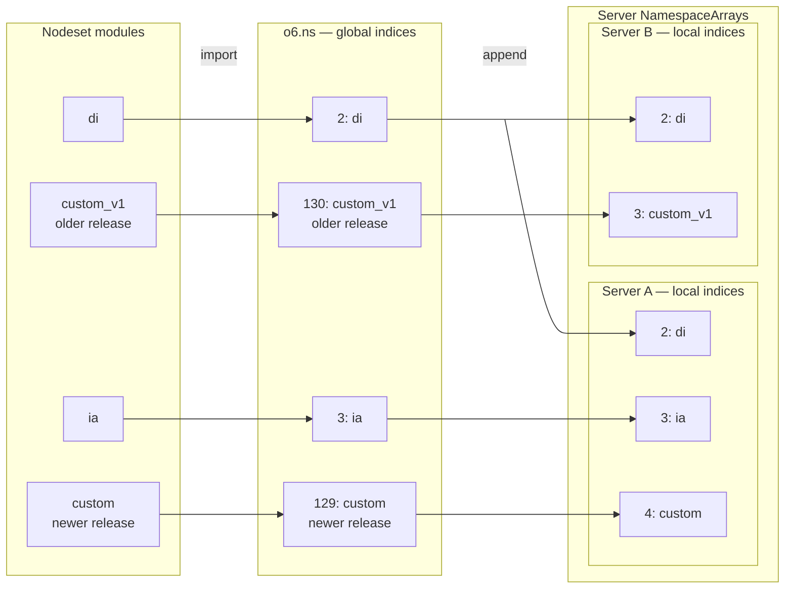

# Loading & Using Nodesets

An application declares which nodesets it uses. This page covers packaged companion specifications and custom nodesets.

!!! info
    For what a nodeset file is, how companion specifications relate to it, and
    how nodesets declare their dependencies, see
    [Nodeset Files & Companion Specs](../../opcua-fundamentals/nodesets-and-companion-specs.md)
    in OPC UA Fundamentals.

o6\\Python separates loading a nodeset from using it on a server:



1. Loading a nodeset module creates an entry for it in the process-wide `o6.ns` table.
2. A server that uses a loaded nodeset appends it. Server A appended `di`, `ia` and `custom`. Server B appended `di` and `custom_v1`, an older release of the same custom model. The two releases have distinct shortnames and global indices but share one URI.

Arrows into the registry represent imports; arrows into a server represent
`server.ns.append(...)`.

The indices are illustrative; entries 0 and 1 are omitted. Server columns use
shortnames to identify the models, while NamespaceArray stores their URIs.

Each client or server maps registry entries to its endpoint's local indices.
Your Python code uses the registered shortname, URI, or process index.
`ns=0` is fixed; `ns=1` is the application-local alias, resolved by the endpoint
handling the operation. For an ID copied from an external browser, follow
[Registry and Namespace Mapping](namespace-mapping-in-o6.md#process-indices-and-server-indices).

---

## Appending packaged companion specs

Packaged companion specifications are compiled Python packages under `o6/ns/`. Import a namespace with ordinary Python import syntax:

```python
import o6
from o6.ns import di            # or: import o6.ns.di
```

`di` is a `NamespaceModule`, a Python module that carries the registry information described in [Namespace Mapping in o6\\Python](namespace-mapping-in-o6.md).

A server publishes the namespace into its address space by appending the module:

```python
server = o6.Server(port=4840)
server.ns.append(di)
with server:
    input("Press Enter to stop the server\n")
```

`append` registers every namespace the module declares (its `__NAMESPACES__` set) with the server's NamespaceArray, then adds the module's nodes and datatypes. Appending the same module twice is a no-op.

!!! warning
    Dependencies are not resolved for you. If a companion specification's types inherit from another specification's types, append the dependency first:

    ```python
    from o6.ns import di, ia   # IA builds on DI

    server.ns.append(di)       # base first
    server.ns.append(ia)
    ```

    Appending `ia` alone does not fail, but DI never reaches the NamespaceArray and the DI-derived parts of the IA model are incomplete.

A client does not append anything; there is no `client.ns`. On connect, the client reads the server's NamespaceArray and maps each advertised URI to the matching entry in `o6.ns`:

```python
# This example requires a server publishing DI and this node.
with o6.Client("opc.tcp://localhost:4840") as client:
    value = client.read("ns=di;i=15889")
```

If a server adds namespaces at runtime, call `client.updateRemoteNamespaces()` to rebuild the mapping. An unchanged NamespaceArray is not rebuilt, so repeated calls are cheap.

When several registrations match a URI, the client uses scope and model
version information to select one. The selection and its version warning
are described in [Namespaces and NodeIds](namespace-mapping-in-o6.md#namespaces-and-nodeids).

### Unknown namespaces and structured values

An unknown namespace URI is registered automatically under the client's scope.
It receives a process index and a namespace module containing identity
metadata. NodeIds and BrowseNames returned by the client use that registration;
they do not remain unmapped server-local numbers. You can browse and work with
built-in values without a nodeset package.

An unknown structured datatype is a separate issue. Namespace registration
does not supply the field layout or a Python class. For a namespace with a
package, import the matching generated model and load its datatype
declarations before connecting when you need decoded structure values.

For a namespace without a package, the client loads the DataType from the
server the first time it receives a value it cannot decode. It browses from
the value's encoding to its DataType, reads the `DataTypeDefinition` of that
DataType, its supertypes and the field types it needs, and registers them.
The value is then decoded from the bytes already received, without being read
again:

```python
with o6.Client("opc.tcp://localhost:4840") as client:
    order = client.read("nsu=http://example.org/workorder/;s=WorkOrder")
    print(order)  # o6.workorder.WorkOrderType(id='A1', amount=7)
```

On-demand decoding applies to `read()`, node values, `call()` outputs and
`historyRead()`. It also applies to values nested in arrays, in Variants and
in fields of known structures, such as the value of a `KeyValuePair`.

- **One lookup per encoding:** the client looks up each encoding at most once,
  whether the lookup succeeds or fails. Concurrent requests for the same type
  wait for the same lookup.
- **Subscriptions and events:** notifications are never held back for a server
  round trip. The first notification of an unknown type is delivered as an
  `ExtensionObject` while the type loads in the background, and later ones
  arrive decoded, in order. Call `loadRemoteDataTypes()` before subscribing
  when the first notification must be decoded too.
- **Raw services:** `serviceRead()`, `serviceCall()`, `serviceHistoryRead()`
  and the other `service*` methods decode only the DataTypes the client
  already has, and never look one up.
- **Opting out:** pass `loadUnknownDataTypes=False` to `Client`, or set
  `client.config.loadUnknownDataTypes = False`, to keep unknown values as
  `ExtensionObject`s without extra requests.

To load every DataType of the server up front, call
`client.loadRemoteDataTypes()` (await it in async code):

```python
with o6.Client("opc.tcp://localhost:4840") as client:
    client.loadRemoteDataTypes()
```

The call registers the structures of every server namespace that has no
package, together with the enumerations their fields use, and returns the new
Python classes. Afterwards reads, method outputs, history and subscriptions
decode these values. This can be done any time after connect.

Both ways share these rules:

- **Packaged namespaces:** are never extended or replaced, even when the server
  has a newer version. A structure the package lacks stays an `ExtensionObject`.
- **Binary encoding only:** values in other encodings stay undecoded. On
  demand, each XML encoding logs one warning.
- **Servers before OPC UA 1.04:** describe structures in DataType dictionaries
  instead of the `DataTypeDefinition` attribute. o6\\Python does not read
  dictionaries, so these structures stay `ExtensionObject`s.
- **Unloadable types:** each one logs a warning on the `o6.informationmodel`
  logger, once per client, and its values stay `ExtensionObject`s.
  `loadRemoteDataTypes()` raises only when the client is not connected or a
  Browse or Read service fails; a failed lookup on demand only warns.
- **Recursive structures:** a structure with a field of its own type, or two
  structures that contain each other, cannot be loaded.
- **Repeated calls:** `loadRemoteDataTypes()` browses the DataTypes again but
  skips the types the client already decodes, also after a reconnect, and
  returns only the newly registered classes.

Even a known packaged namespace can lack loaded datatype declarations, because
its module loads lazily:

### Namespace modules load lazily

Every packaged companion specification is registered in `o6.ns` (shortname, URI, version and global index) when `o6` is imported. The generated declarations execute only on first attribute access:

```python
o6.ns.di.__dict__["_o6_loaded"]     # False — registered, not yet loaded
o6.ns.di.objtypes.DeviceType        # triggers the load
o6.ns.di.__dict__["_o6_loaded"]     # True
```

This keeps startup fast with over a hundred namespaces registered. Naming anything inside a namespace loads it.

!!! warning
    A bare `import o6.ns.di` (or `from o6.ns import di`) does not execute the module, because the placeholder is already in `sys.modules`. Structured DataTypes are registered with the codec when the module loads. A client that never touches a declaration therefore decodes that namespace's structures as opaque `ExtensionObject`s:

    ```python
    import o6.ns.ia
    client.read(node)          # → o6.ExtensionObject(typeId='ns=ia;i=5009', body=b'...')

    o6.ns.ia.datatypes         # force the load
    client.read(node)          # → RGBWDataType
    ```

    This only happens when you read values whose types your code never names. In that case, access the category module (or the type) before connecting.

---

## Loading nodesets from XML

Runtime parsing of `*.NodeSet2.xml` is not supported. Compile the XML once,
then import the generated package. Clients use its datatypes to decode values;
servers can also publish its nodes.

For a model that depends only on the standard namespace, install the compiler
in your development environment:

```sh
pip install o6-ncc
```

Replace `path/to/MyModel.NodeSet2.xml` with your XML file:

```sh
--8<-- "docs/snippets/compile-nodeset.sh"
```

This creates `./mymodel/`. Run Python from that directory's parent, or install
the generated package with your application:

```python
--8<-- "docs/snippets/use-compiled-nodeset.py"
```

Import the declarations before connecting a client that needs their custom
datatypes. Model-specific classes live under categories such as
`mymodel.datatypes`; the categories are described below.

The `-e ns0` argument supplies the standard namespace. Models that depend on
DI or other models need those dependencies supplied too. Generation replaces
the output package's Python files, so keep handwritten application code outside
`mymodel/`. The complete [Compiling Nodesets](../../information-model-authoring/compiling-nodesets.md)
guide covers dependency chains, packaging, regeneration, and diagnostics.

## Accessing namespace content

A namespace module exposes its address space through five generated category submodules:

| Category | Contains |
|---|---|
| `reftypes` | `ReferenceType` declarations |
| `datatypes` | structures, enums, unions |
| `vartypes` | `VariableType` declarations |
| `objtypes` | `ObjectType` declarations |
| `instances` | `Object` / `Variable` / `Method` instance declarations |

```python
import o6

dt = o6.ns.di.datatypes.TransferResultDataDataType   # a struct class
value = dt()                                         # {sequenceNumber=0, endOfResults=False, parameterDefs=[]}
value.sequenceNumber = 42

health = o6.ns.di.datatypes.DeviceHealthEnumeration  # an enum
health.NORMAL                                        # 0

DeviceType = o6.ns.di.objtypes.DeviceType            # a decorated type class
o6.NodeId(DeviceType)                                # ns=di;i=1002

ConnectsTo = o6.ns.di.reftypes.ConnectsTo
o6.NodeId(ConnectsTo)                                # ns=di;i=6030
```

Declarations are flat within their category — inheritance is plain Python inheritance, not attribute nesting:

```python
issubclass(
    o6.ns.di.datatypes.TransferResultDataDataType,
    o6.ns.di.datatypes.FetchResultDataType,           # abstract parent, same module
)
```

You can import the category modules directly, for tab completion in a REPL and for short names in application code:

```python
import o6.ns.di.objtypes as diot
from o6.ns.di import datatypes as didt
from o6.ns import ns0

req = ns0.datatypes.ReadRequest()
nodeId = o6.NodeId(diot.DeviceType)
```

Only the category modules are submodules; a declaration is not. `import o6.ns.di.datatypes.TransferResultDataDataType` raises `ModuleNotFoundError`. Use `from o6.ns.di.datatypes import TransferResultDataDataType`.

### Namespace metadata

Metadata is an attribute of the module:

```python
di = o6.ns.di
di.shortname          # 'di'
di.uri                # 'http://opcfoundation.org/UA/DI/'
di.version            # '1.05.0'
di.publicationDate    # '2025-11-15T00:00:00Z'
di.scope              # '::global'
di.index              # the process-global index — assigned at registration,
                      #   stable within a process, not something to hard-code
repr(di)              # <o6 namespace 'di' version='1.05.0' uri='http://opcfoundation.org/UA/DI/'>
```

Shortname, URI, version, scope and index come from the registry and are readable before the module loads. The module itself sets `publicationDate`, so it reads `''` until the namespace has loaded.

### Instances

Instance declarations that carry a usable BrowseName get a lowerCamelCase Python name:

```python
device_set = o6.ns.di.instances.deviceSet
o6.NodeId(device_set)                 # ns=di;i=5001
```

Names are derived from the BrowseName:

- Each run of characters that cannot appear in an identifier collapses to a single `_`.
- A leading `_` is dropped.
- A leading digit is spelled out.

A placeholder `<CPIdentifier>` becomes `cPIdentifier_`, and a URI-shaped BrowseName becomes a long `_`-separated name. Names that differ only in their separators (`My Variable`, `My-Variable`, `My_Variable`) all become `my_Variable`. The generator resolves a collision within one scope by appending `_2`, `_3`. Declarations without a hierarchical parent may have no public name. When a name is ambiguous or absent, look up the declaration by NodeId. [BrowseName to Python Names](../../node-api/name-conversion.md) documents the full rule with examples.

### Looking up a declaration by NodeId

The `o6.ns` registry is subscriptable:

```python
declaration = o6.ns["ns=di;i=5001"]

# A NodeId object works too.
o6.ns[o6.NodeId("ns=di;i=5001")]

# As with every NodeId string, an omitted namespace means namespace 0.
root = o6.ns["i=84"]

# An integer key returns the namespace module for that global index.
o6.ns[o6.ns.di.index]                 # <o6 namespace 'di' ...>
```

For a type node, the lookup returns the decorated type class. For an instance node, it returns the registered instance declaration. You can pass either result to `o6.NodeId(...)`. The lookup reads the compiled namespace, not a live server; use `client[nodeid]` for a typed node bound to a server. It raises `KeyError` if the generator emitted no declaration for the NodeId.

Brackets accept only indices and NodeIds. A bare shortname raises `TypeError` that points you to attribute access:

```python
o6.ns["di"]        # TypeError: use o6.ns.di for namespace shortname access; ...
```

The lookup index is built lazily from the loaded namespace module and cached. It does not depend on generated backing names such as `__property_2`, and it adds no lookup tables to the generated modules.

### Querying the registry

```python
print(o6.ns)                          # the formatted table (see Namespace Mapping)
len(o6.ns)                            # number of registered namespaces
list(o6.ns)                           # ['ns0', 'amb', 'aml', ...] — shortnames
"di" in o6.ns                         # True — shortname membership
"ns=di;i=5001" in o6.ns               # True — declaration membership

o6.ns.filter(uri="http://opcfoundation.org/UA/DI/")
o6.ns.filter(version="1.05.0")
o6.ns.filter(scope="::global")
o6.ns.filter()                        # every entry, as NamespaceModule objects
```

`filter()` is the programmatic counterpart to printing the table. Use it for URI, scope or version queries, and attribute access for shortnames.

To declare a new namespace, see
[Writing a Namespace Module](../../information-model-authoring/namespace-modules.md).

## Practical use of shortname

A model's registered `shortname` is its attribute name in `o6.ns.di`,
`o6.ns.machinery`, or `o6.ns.custom`, and can be used in NodeId strings without
server-assigned indices. Automatically generated client shortnames belong to
that client; persist the URI and node identifier instead of those names.

A `NodeId` accepts a registered shortname in its `ns=…` form. The `nsu=…`
form takes a full namespace URI, optionally qualified by scope and
version:

````python
# URI form — full namespace URI
n1 = o6.NodeId("nsu=http://opcfoundation.org/UA/DI/;i=1")

# Shortname form — same NodeId, much easier to type
n2 = o6.NodeId("ns=di;i=1")

# URI + scope + version — for when several versions of the same nodeset
# live side by side
n3 = o6.NodeId("nsu=http://opcfoundation.org/UA/DI/@::global!1.05.0;i=1")

# Numeric form still works — but the index is the *global* one, not the
# index the server put on the wire
n4 = o6.NodeId(f"ns={o6.ns.di.index};i=1")
````

With one installed DI registration at the specified version, all four
normalise to `ns=di;i=1`. `QualifiedName` accepts the shortname the same way:

````python
o6.QualifiedName("ns=di;DeviceSet")   # di:DeviceSet
````

A `NodeId` exposes a registered namespace module through `.ns`, even when the
module contains only an automatically discovered URI and no declarations.
The application-local alias 1 and unregistered numeric indices return integers:

````python
n = o6.NodeId("ns=di;i=1")

n.ns                                # → o6.ns.di
n.ns.index                          # → process-global index
n.ns.shortname                      # → 'di'
n.ns.uri                            # → 'http://opcfoundation.org/UA/DI/'
n.ns.version                        # → '1.05.0'
n.ns.publicationDate                # → '2025-11-15T00:00:00Z'
n.ns.scope                          # → '::global'

o6.NodeId("ns=1;i=1").ns            # → 1, the application-local namespace
````

!!! tip
    Prefer registered model shortnames or URIs over numeric process indices.
    Namespace 0 is fixed and `ns=1` is the application-local alias. Other
    numeric indices select process entries, which need not match the server's
    NamespaceArray. See [Registry and Namespace Mapping](namespace-mapping-in-o6.md)
    for scope, version, and external-browser examples.

---

## Related topics

| Topic | What it covers |
|---|---|
| [Compiling Nodesets](../../information-model-authoring/compiling-nodesets.md) | Compiling nodeset XML into an importable package. |
| [Writing a Nodeset in Python](../../information-model-authoring/namespace-modules.md) | Declaring namespaces and types directly in Python. |
| [Implementing Object Behavior](../../information-model-authoring/implementing-types.md) | Adding behaviour to declared Methods and Variables. |
| [Part 6, Annex F — Information Model XML Schema](https://reference.opcfoundation.org/Core/Part6/v105/docs/F) | The normative UANodeSet XML schema. |
| [`OPCFoundation/UA-Nodeset`](https://github.com/OPCFoundation/UA-Nodeset) | Versioned XML schemas and published nodeset files. |
| [Namespace](../../opcua-fundamentals/namespace.md) | Namespace arrays and the reserved local-server namespace. |
| [Part 5, §6.3.1 — ServerType](https://reference.opcfoundation.org/Core/Part5/v105/docs/6.3.1) | The server's namespace information. |
| [Part 3, §4.2 — URIs](https://reference.opcfoundation.org/Core/Part3/v105/docs/4.2) | URI definitions in the OPC UA specification. |
| [DataType](../../opcua-fundamentals/datatype.md) | DataTypes and their Python representation. |
| [Address & Identity Types](../builtin/address-types.md) | NodeIds and qualified names for loaded namespaces. |
| [OPC UA Companion Specifications](https://opcfoundation.org/about/opc-partners/opc-unified-architecture/opc-ua-companion-specifications/) | The official catalogue of companion specifications. |
| [Namespace Mapping in o6\\Python](namespace-mapping-in-o6.md) | The process-wide namespace registry. |
