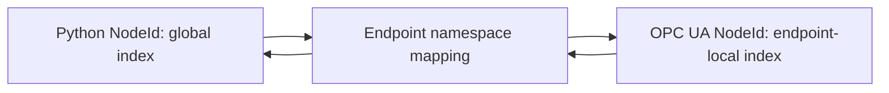

# Registry

`o6.ns` is the process-wide namespace registry. It associates shortnames,
URIs, scopes, versions, and Python declaration modules with global indices.
See [Namespace](../../opcua-fundamentals/namespace.md) for OPC UA namespace arrays.



## Identity and lookup

| Field | Meaning |
| --- | --- |
| Shortname | Python attribute name, such as `di`; unique in the registry |
| URI | Namespace identifier exchanged with peers |
| Version | Distinguishes registered versions sharing a URI |
| Scope | `::global` for shared definitions; endpoint scope for discovered definitions |
| Index | Process-wide numeric identifier; index 1 is reserved for the application namespace |

```python
import o6

print(o6.ns)                         # Registered names and metadata
namespace = o6.ns.di
assert o6.ns[namespace.index] is namespace
declaration = o6.ns["ns=di;i=5001"]
node_id = o6.NodeId("ns=di;i=5001")
browse_name = o6.QualifiedName("ns=di;DeviceSet")
```

- Attribute lookup returns a namespace module.
- Numeric lookup returns the module at that global index.
- NodeId lookup returns a registered declaration.
- `o6.ns.filter()` selects entries by URI, scope, or version.
- Different versions of one URI require distinct shortnames and global indices.

Do not persist dynamically assigned global indices as portable identifiers.
Store the namespace URI and node identifier, then resolve the index in the
current process.

## Endpoint mappings

Clients establish a local-to-global mapping during connection setup. Servers
establish mappings when publishing namespaces. Conversion applies these
mappings to namespace-bearing values, including nested values.

An endpoint-local index need not equal its process-wide index. A remote
application namespace is scoped to that endpoint. Shared `::global`
definitions should be treated as immutable; the registry does not enforce
that a remote server leaves its namespace contents unchanged.

## Packaged models

Companion models are generated from the OPC Foundation UA-Nodeset sources.
Use `print(o6.ns)` to inspect the names, URIs, and versions in the installed
package. Access declarations through `o6.ns.<shortname>`; publish the required
module through `server.ns.append(...)` when building a server address space.
