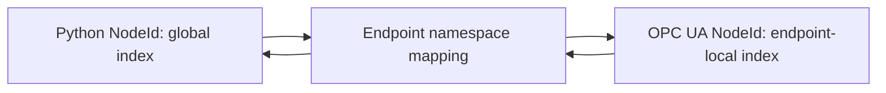

# Registry and Namespace Mapping

`o6.ns` is the process-wide namespace registry. It associates namespace
URIs with shortnames, scopes, versions, and Python modules. A module can hold
only a namespace's identity or also contain model declarations.

## Process indices and server indices

A server's NamespaceArray assigns its local namespace indices. The `o6.ns`
registry assigns process-wide indices independently. Clients and servers
translate between them when exchanging namespace-bearing values:



For example, suppose DI has process index `7`, but a server publishes its URI
at local index `2`. Python uses `ns=di;i=5001`, internally index `7`; the client
sends `ns=2;i=5001` to that server. Received namespace indices are translated
back. Writing `ns=2;i=5001` in Python would select process entry `2`, which may
be a different namespace. These numbers are illustrative, not DI constants.

There are two reserved cases:

- `ns=0` always identifies the OPC UA standard namespace.
- `ns=1` is an application-local alias. In a client operation it means
  namespace 1 of that client's server; in a server operation it means that
  local server's namespace 1. A standalone `NodeId("ns=1;...")` does not
  identify a particular server.

These rules also apply to QualifiedNames and namespace-bearing values nested
inside structures. Prefer registered shortnames or URIs in application code.
Do not persist process indices as portable identifiers: store the URI and
identifier, then resolve them in the current process.

An ID copied from another OPC UA browser can use different numeric indices.
Use its namespace URI instead, for example
`nsu=http://opcfoundation.org/UA/DI/;i=5001`. For a convenient shortname, look up
the URI in the registry:

```python
import o6

for namespace in o6.ns.filter(uri="http://opcfoundation.org/UA/DI/"):
    print(namespace.shortname)              # di
```

A client registers unknown namespace URIs on connection. If several entries
share a URI, use [scope or version](#scope-and-version-in-identifiers) to select
one. NodeIds returned by this SDK are already mapped and can be reused directly.

## Identity and lookup

| Field | Meaning |
|---|---|
| Shortname | Registry name, such as `di`; unique in the process. |
| URI | Namespace identity exchanged with peers. |
| Version | Model version associated with a registration. |
| Scope | Separates shared definitions from client- or endpoint-specific identities. |
| Index | Process-wide numeric slot; index 1 is reserved for the application-local alias. |

```python
import o6

print(o6.ns)                         # Registered names and metadata.
namespace = o6.ns.di
assert o6.ns[namespace.index] is namespace
declaration = o6.ns["ns=di;i=5001"]
node_id = o6.NodeId("ns=di;i=5001")
browse_name = o6.QualifiedName("ns=di;DeviceSet")
```

Attribute lookup returns a namespace module; numeric lookup returns the
module at a process index. NodeId lookup in `o6.ns` returns a model declaration,
not a live server node. Identity registration alone supplies no declarations;
use `client[node_id]` for a live node.

### Scope and version in identifiers

The `nsu=` form of `o6.NodeId` and `o6.QualifiedName` accepts the SDK syntax
`<uri>@<scope>!<version>`. Scope and version are optional filters on existing
registrations; they do not change the URI sent to the server, load a model,
or ask a server to switch model versions.

For example, select the installed DI registration explicitly:

```python
from o6.ns import di

node_id = o6.NodeId(f"nsu={di.uri}@{di.scope}!{di.version};i=5001")
assert node_id == o6.NodeId("ns=di;i=5001")
```

Use `o6.ns.filter(uri=uri)` to inspect the available entries. Its optional
`scope=` and `version=` filters combine with AND. A URI form with no matches
or multiple matches fails to parse; it never chooses an arbitrary entry.
A registered shortname selects one entry directly.

Shared model definitions use scope `::global`. Automatically discovered
namespaces at server index 2 or above use the client's name as scope: for a
client named `reader`, `nsu=<uri>@reader;s=Temperature` selects its registration.

## Namespaces and NodeIds

On a normal client connection, the SDK reads the server's application identity
and NamespaceArray and establishes the mapping:

- Namespace 1 gets a registration named `<clientname>_ns1`, scoped to the
  endpoint URL. This gives returned identifiers a concrete namespace identity
  while preserving `ns=1` as an input alias.
- For indices 2 and above, the client matches the URI against registrations
  in its own scope or `::global`. If none match, it creates an identity-only
  registration in its own scope, with a generated shortname.
- If several versions match, the client tries to find an exact version using
  NamespaceMetadata. Without usable metadata or an exact match, it prefers
  its own scope, then the highest version. A reported server version newer than the selected model
  produces a warning during this ambiguity check.

Do not hard-code generated client shortnames or indices. Client names are
unique in a process, so two clients can register the same unknown URI under
different shortnames and scopes. For example, a BrowseName returned from
namespace 1 can expose the registration's metadata:

```python
# Fragment inside a connected client's context; the Variable must exist.
name = client.read("ns=1;s=IntegerVariable", attr="BrowseName")
print(name.ns.shortname, name.ns.uri, name.ns.scope)
```

A metadata-only registration is enough to browse nodes and read or write
built-in values. It does not teach the decoder an unknown structure layout;
see [Unknown namespaces and structured values](loading-and-using-nodesets.md#unknown-namespaces-and-structured-values).

If a connected server adds namespaces at runtime, call
`client.updateRemoteNamespaces()` before using them; await it in async code.
A failed refresh preserves the previous mapping, and an unchanged mapping
is not rebuilt. Registration entries remain in `o6.ns` after disconnect.
The optional [Namespace matching](../../implementation-details/namespace-matching.md)
page explains the selection algorithm.

## Packaged models

Packaged companion models register their namespace identities when `o6` is
imported; their declarations load lazily. Access them through
`o6.ns.<shortname>`. A server publishes a model with `server.ns.append(...)`;
a client has no append step. See
[Loading & Using Nodesets](loading-and-using-nodesets.md) for datatype loading
and model publication.
