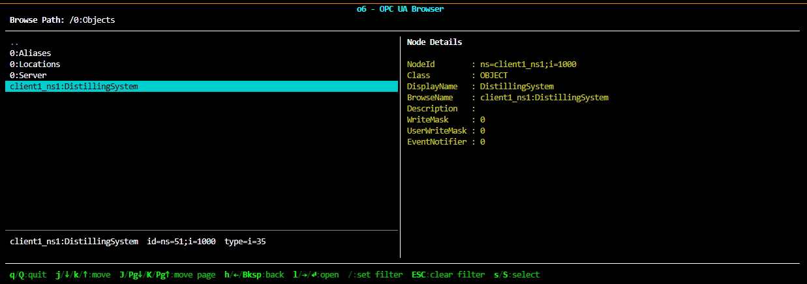

# Browse & Explore

To read a value, call a method or subscribe, you need the node's NodeId. Hard-coding NodeIds assigned by the server is error prone. The browse service traverses the server's address space and returns the NodeIds you look for.

This page covers:

 - browsing interactively
 - the browse service
 - filtering browse results

Start the [example server](../setup.md) in the background before you run the snippets.

---

## Browsing Interactively

`Client.browseInteractive()` opens a lightweight command-line browser for exploring an unfamiliar server.

```python
from o6 import Client

with Client("opc.tcp://localhost:4840") as client:
    selected = client.browseInteractive()
    # Arrow keys to explore the address space,
    # 's' to select the node under the curser and exit with it's nodeid/browse path
    # 'q' quits and returns None
    print(selected)
```

!!! info
    Requires the `curses` module (install `windows-curses` on Windows).

<div style="max-width: 660px; margin: 0 auto; padding: 0 1rem;">
  
</div>

The browser starts at the server's root node.
The top line shows the current node's full browse path.
The right side lists the node's child references; the left side shows details of the selected node.
Navigate with the arrow keys and quit with `q`.
Open the Objects node to find the DistillingSystem of the example server.

Pass a NodeId to start inside a known subtree:

```python
client.browseInteractive("ns=1;i=1000")   # start inside DistillingSystem
```

On exit, the browser returns the selected node's NodeId or its full browse path from the root, as a string:

```python
selected = client.browseInteractive()
```

```python
from o6 import Client

with Client("opc.tcp://localhost:4840") as client:
    selected = client.browseInteractive()
    # Arrow keys to explore the address space,
    # 's' to select the node under the curser and exit with it's nodeid/browse path
    # 'q' quits and returns None
    print(selected)
```

---

## The browse service

`client.browse(target)` takes a NodeId and returns a `list[ReferenceDescription]` of the node's references. The default direction is forward and the default reference type is HierarchicalReferences (includes `HasComponent`, `HasProperty`, `Organizes` and their subtypes).

```python
refs = client.browse("ns=1;i=1000")   # DistillingSystem
for ref in refs:
    print(ref.browseName.name, "→", ref.nodeId, ref.nodeClass.name)
```

Output (abbreviated):

```
Identification → ns=client1_ns1;i=1100 OBJECT
Status         → ns=client1_ns1;i=1200 OBJECT
Kettle         → ns=client1_ns1;i=1300 OBJECT
Distillate     → ns=client1_ns1;i=1400 OBJECT
Actuators      → ns=client1_ns1;i=1500 OBJECT
Events         → ns=client1_ns1;i=1600 OBJECT
Start          → ns=client1_ns1;i=2001 METHOD
Shutdown       → ns=client1_ns1;i=2002 METHOD
```

Each `nodeId` is a local `ExpandedNodeId`. Its printed namespace is the shortname `o6` registered for `ns=1` on connect (`client1_ns1`). You can still address the node as `"ns=1;i=1100"` in `read` / `write` / `call`. See [Namespaces in o6](../../manual/sdk-fundamentals/namespace/namespace-mapping-in-o6.md#namespaces-and-nodeids).

The interactive browser uses the same call to list a node's child references.

!!! info
    `browse()` and `browsePage()` default to `BrowseResultMask.ALL`, which returns `referenceTypeId`, `isForward`, `browseName`, `displayName`, `nodeClass` and `typeDefinition` with the target `nodeId`. Pass a `resultMask` to select fewer fields; `BrowseResultMask.NONE` (zero) returns only target IDs. Local target IDs display registered namespace shortnames and can be reconstructed from their string form.

#### Putting it all together

```python
from o6 import Client
from o6.ns.ns0.datatypes import BrowseResultMask

with Client("opc.tcp://localhost:4840") as client:
    # 1. Start at DistillingSystem
    refs = client.browse("ns=1;i=1000", resultMask=BrowseResultMask.BROWSE_NAME | BrowseResultMask.NODE_CLASS)

    # 2. Pick the Kettle object and walk one level into it
    kettle = next(r.nodeId for r in refs if r.browseName.name == "Kettle")
    for ref in client.browse(kettle, resultMask=BrowseResultMask.BROWSE_NAME | BrowseResultMask.NODE_CLASS):
        print(ref.browseName.name, "—", ref.nodeClass.name)
```

!!! info
    `client.browse()` follows server-issued continuation points with `BrowseNext` until the result is exhausted. The returned list is complete even when the server splits a large result into batches.

---

## Filtering the result

Nodes also have `HasTypeDefinition`, `HasModellingRule`, inverse and other non-hierarchical references. Use the filter parameters of `browse()` to narrow the result.

**`direction=...`** — `FORWARD` (default), `INVERSE` or `BOTH`. Forward returns the nodes this node points at; inverse returns the nodes that point at it.

```python
# Who points at DistillingSystem? (answer: Objects folder)
refs = client.browse("ns=1;i=1000", direction=o6.ns.ns0.datatypes.BrowseDirection.INVERSE)
```

**`reftype=...`** — restrict to one reference type (default `HierarchicalReferences`):

```python
# Only HasComponent edges (variables, methods, nested objects)
client.browse(
    "ns=1;i=1000",
    reftype=o6.ns.ns0.reftypes.HasComponent,
)
```

**`nodeClassMask=...`** — restrict the targets to node classes (`Object`, `Variable`, `Method`, …), for example all variables under an object:

```python
vars_only = client.browse(
    "ns=1;i=1000",
    nodeClassMask=NodeClass.VARIABLE,
)
```

#### Putting it all together — list every writable variable

Browse `DistillingSystem` filtered to `Variable` nodes:

```python
import o6
from o6 import Client
from o6.ns.ns0.datatypes import BrowseResultMask, NodeClass

with Client("opc.tcp://localhost:4840") as client:
    writable = client.browse(
        "ns=1;i=1000",
        direction=o6.ns.ns0.datatypes.BrowseDirection.FORWARD,
        nodeClassMask=NodeClass.VARIABLE,
        resultMask=BrowseResultMask.BROWSE_NAME,
    )
    for ref in writable:
        print(ref.browseName.name, "→", o6.NodeId(f"nsu={ref.nodeId.ns.uri};{ref.nodeId.id}"))
```

!!! info
    Filtering with `nodeClassMask` is cheaper than filtering in Python because the server returns only matches.

!!! note "Server-side nodeClassMask caveat"
    Some OPC UA servers ignore `nodeClassMask` on `Browse`. If `browse(..., nodeClassMask=...)` returns nothing for a node that has children, drop the mask and filter client-side:

    ```python
    vars_only = [
        ref for ref in client.browse("ns=1;i=1000")
        if ref.nodeClass == o6.NodeClass.VARIABLE
    ]
    ```

    The distilling tutorial server is one of those. The `nodeClassMask=NodeClass.VARIABLE` call above is correct; if it returns zero results, use the client-side filter.


## Next steps

| Topic | What it covers |
|---|---|
| [Reading & Writing](120_read-write-node.md) | Reading and writing node values and attributes. |
