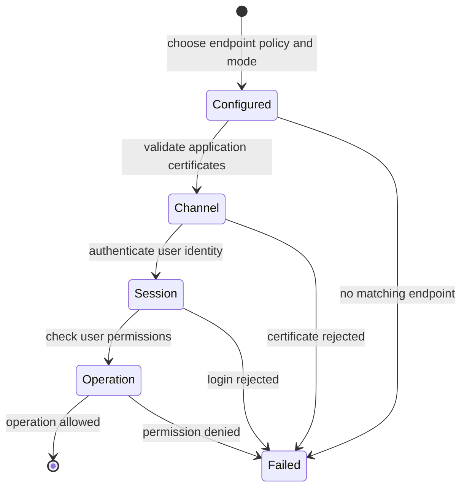

# Security

Secure the connection to the distillery with certificates, encryption and a user login.

On an open channel, anyone who can reach the server can browse it, read the Kettle values, write `Setpoint` and call `Shutdown`. Two clients connect to the distillery in production:

- A *control plane* runs the recipe. It writes the setpoint and starts batches.
- An *HMI dashboard* shows the process to an operator. It only reads and subscribes to events.

The configuration has four parts:

1. **Message protection.** Signing detects tampering; encryption protects message contents from eavesdropping.
2. **Channel authentication.** Each side knows it talks to the party whose certificate it trusts.
3. **User authentication.** The server checks the user-identity token (`username`/`password`) before it accepts the session.
4. **Authorization.** The server checks which operations the user may perform.

The default [`Client(...)`](../../api_reference/client.md) constructor opens an unencrypted channel (`SecurityPolicy.NONE` / `SecurityMode.NONE`). In production, use an encrypted connection with mutual certificate trust.



The diagram summarizes checks, not values returned by `client.state`.
Certificate trust identifies the applications. The channel mode determines
whether messages are signed or encrypted. The server separately authenticates
the user and authorizes each operation.

!!! info
    This tutorial expects the [example server running](../setup.md) in the background. It builds on [Connect](100_connect.md), [Browse](110_browse.md) and [Read and write](120_read-write-node.md). The snippets use the distillery's `DistillingSystem` at `ns=1;i=1000` and the writable `Status.Setpoint` at `ns=1;i=1204`.

!!! warning
    The example server from [Set the Stage](../setup.md) takes no certificate, trust list or `UserTokenPolicy` arguments. It always runs with `SecurityMode.NONE` and anonymous sessions. The secured client configurations below require a server with matching security settings. To run them end to end, start a server with the matching certificate, trust list and `UserTokenPolicy` (see the [complete secured client/server example](../../manual/server/security.md#a-secured-clientserver-pair)). That example uses a single Temperature Variable; it does not configure the distillery model used here.

---

## Generate or load a certificate and private key

Client and server each need an X.509 certificate so the other side can trust them. If you don't have one, generate a self-signed pair with `o6.util`:

```python
from pathlib import Path
from o6.util import createSelfSignedCertificate

cli_key, cli_cert = createSelfSignedCertificate(
    appUri="urn:example:client",
    commonName="ExampleClient@localhost",
)
```

Both return values are raw DER `bytes`. Write them to disk to reuse them:

```python
Path("client_key.der").write_bytes(cli_key)
Path("client_cert.der").write_bytes(cli_cert)
```

Give separate client applications distinct application URIs and certificates. These identify applications; the user token supplies the login identity. A `UserTokenPolicy` advertises token types and their cryptographic protection, not application or user permissions.

o6\\Python accepts the certificate and key as `bytes`, a `pathlib.Path` or a path string.

---

## Exchange certificates with the server

The server must trust the client's certificate, and the client must trust the server's. In a deployment, hand each certificate to the operators of the other side. For development, generate both and load each into the other side's trust list.

- Pass the trusted server certificates to `Client` as `trustList=`. Without a trust list, a client with a certificate rejects every server. Use `acceptAllCertificates=True` only for development; it bypasses server-certificate validation.
- The client's `applicationUri` must match the `ApplicationUri` in the client certificate. Pass the same URI to `createSelfSignedCertificate(appUri=...)` and to the client constructor.

```python
from o6.util import createSelfSignedCertificate
from pathlib import Path

# Generate *both* sides for a local round-trip test
cli_key, cli_cert = createSelfSignedCertificate(
    appUri="urn:example:client",
    commonName="ExampleClient@localhost",
)
srv_key, srv_cert = createSelfSignedCertificate(
    appUri="urn:example:server",
    commonName="ExampleServer@localhost",
)

# Persist so the server can be started with the matching certificate
Path("client_key.der").write_bytes(cli_key)
Path("client_cert.der").write_bytes(cli_cert)
Path("server_key.der").write_bytes(srv_key)
Path("server_cert.der").write_bytes(srv_cert)
```

!!! info
    Start the server with `client_cert.der` in its `trustList=` so it accepts this client. See [Server](../../manual/server/index.md) for the server-side constructor.

---

## Pick a security policy, mode, and user token

OPC UA configures three things separately:

- **`securityPolicy=`** chooses the cryptographic suite: the algorithms for signing and encrypting messages.
- **`securityMode=`** chooses what is applied to each message: sign only, or sign and encrypt.
- **`username` / `password`** supplies the user token sent in `ActivateSession`. The server authenticates it in `AccessControl.activateSession` and applies its authorization rules separately.

The policy and mode enums are in the top-level `o6` namespace:

```python
from o6 import SecurityPolicy, SecurityMode

policy = SecurityPolicy.BASIC256SHA256
mode   = SecurityMode.SIGN_AND_ENCRYPT
```

`SecurityPolicy` choices for RSA certificates, newest first: `AES256_SHA256_RSAPSS`, `AES128_SHA256_RSAOAEP`, `BASIC256SHA256`, `BASIC256`, `BASIC128RSA15`. The last two are deprecated; don't use them for new connections. The `ECC_*` members name the elliptic-curve policies, which need an ECC certificate.

`securityPolicy=` also accepts the full URI, or the short name after `#` in any case, such as `"Basic256Sha256"` or `"aes128_sha256_rsaoaep"`. An unknown short name raises `ValueError`.

The `SecurityMode` enum contains these values:

| Mode | What it means | What it leaves you open to |
|---|---|---|
| `INVALID` | Unspecified/invalid mode; not a diagnosis of why a connection failed. | Choose an explicit mode when configuring a secured connection. |
| `NONE` | No signing, no encryption. The default `Client(...)` constructor opens this channel. | Anyone on the wire can read and tamper with messages. Use only for local development. |
| `SIGN` | Every message is signed, but not encrypted. Tampering is detected; contents are still readable. | Passive eavesdroppers can see the values. |
| `SIGN_AND_ENCRYPT` | Messages are signed and encrypted. | Certificate trust and user permissions still need to be configured. |

For the two distillery applications, configure server-side rules so `hmi`
can read and subscribe, while `control` can also write and call Methods. Both
clients use `SIGN_AND_ENCRYPT`; their user identities select their permissions.
These rules are application configuration, not built-in meanings of those
usernames. The server must implement them through its access-control hooks or
its default role-permission checks, as explained in
[Access Control & Roles](../../manual/server/security.md).

With those rules installed, an HMI write can return `BadUserAccessDenied`
although its channel and login are valid.

---

## Build the secure client

Pass the certificate, key, trust list, policy, mode, application URI and user token as keyword arguments to `Client`:

```python
from pathlib import Path
from o6 import Client, SecurityPolicy, SecurityMode

client = Client(
    "opc.tcp://localhost:4840",
    certificate     = Path("client_cert.der"),
    privateKey     = Path("client_key.der"),
    trustList      = [Path("server_cert.der")],
    securityMode   = SecurityMode.SIGN_AND_ENCRYPT,
    securityPolicy = SecurityPolicy.BASIC256SHA256,
    applicationUri = "urn:example:client",
    username        = "control",
    password        = "s3cr3t",
)
```

Connect the client:

```python
# tutorial-check: skip — the example server intentionally has no secure endpoint
client.connect()
print(client.connected)   # True
client.disconnect()
```

The handshake completes when both applications trust the peer certificate, the endpoint matches the requested policy and mode, and the server authenticates the username/password token.

If the trust chain, the policy negotiation or the `ActivateSession` step fails, `connect()` raises. The most common cause is a server that doesn't trust the client certificate, which surfaces as `BadSecurityChecksFailed` or a similar status code.

!!! info
    Build the same client with `username="hmi"`. The connect succeeds, but `client.write("ns=1;i=1204", 90.0)` returns `BadUserAccessDenied` if the server's authorization rules deny the HMI that operation. Check the returned StatusCode; a Node API write raises `StatusCodeError` instead. The same write from the control plane succeeds.

#### Putting it all together

```python
# tutorial-check: skip — requires the matching secure server configuration
from pathlib import Path
from o6 import Client, SecurityPolicy, SecurityMode

# Control plane: can read, write, call methods.
with Client(
    "opc.tcp://localhost:4840",
    certificate=Path("client_cert.der"),
    privateKey=Path("client_key.der"),
    trustList=[Path("server_cert.der")],
    securityMode=SecurityMode.SIGN_AND_ENCRYPT,
    securityPolicy=SecurityPolicy.BASIC256SHA256,
    applicationUri="urn:example:client",
    username="control",
    password="s3cr3t",
) as client:
    # Read the current state
    setpoint = client.read("ns=1;i=1204")
    print("setpoint:", setpoint)

    # Write a new setpoint (allowed for the "control" user)
    status = client.write("ns=1;i=1204", 90.0)
    print("write status:", status)
```

---

## Diagnosing failed connections

`connect()` raises when setup fails. Read the exception's StatusCode and the
client/server logs; failures do not all appear as `SecurityMode.INVALID`.

| Check | What must match |
|---|---|
| Endpoint | The server must offer the requested policy and mode. An explicitly requested secured mode does not fall back to `NONE`. |
| Certificates | Each peer must trust the other's certificate, and the application URI must match the certificate. |
| User token | The endpoint must support the token type; the server's authentication callback must accept the identity. |
| Discovery | A server with `secureOnly=True` needs a client that can skip ordinary unencrypted discovery using a preconfigured endpoint. See [Server security configuration](../../manual/server/lifecycle.md#security). |

A correct password with the wrong application certificate can fail before
user authentication. A trusted application certificate with an unknown user
can fail during authentication. A successful connection followed by
`BadUserAccessDenied` on a write is an authorization problem, not a reason to
weaken the channel settings.

To inspect advertised policies and modes, open a discovery channel and ask for
endpoints. This does not require a user Session. The fragment assumes the
server permits ordinary discovery:

```python
# tutorial-check: skip — requires the separately configured secure server
from o6 import Client

discovery = Client("opc.tcp://localhost:4840")
discovery.connect(noSession=True)
endpoints = discovery.getEndpoints("opc.tcp://localhost:4840")
for endpoint in endpoints:
    print(endpoint.securityPolicyUri, endpoint.securityMode, endpoint.userIdentityTokens)
discovery.disconnect()
```

`noSession=True` also works when the server rejects anonymous Sessions.
Compare the endpoint descriptions with the policy, mode and user-token type
your application requested.

---

## Next steps

| Topic | What it covers |
|---|---|
| [Application Description](310_application-description.md) | Identify the client to the server and discover servers. |
| [Low-level service calls](500_lowlevel-service-calls.md) | Send a raw `ActivateSession` request for user-identity tokens other than `username`/`password` (certificate, issued token, …). |
